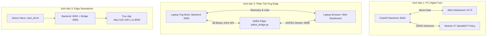

# CS532 — AUTONOMOUS JETBOT NAVIGATION & PERCEPTION SYSTEM
### HỆ THỐNG ĐIỀU HƯỚNG TỰ HÀNH & NÉ VẬT CẢN JETBOT ĐA TẦNG (2026)

---

## 📌 1. Giới Thiệu Tổng Quan (Project Overview)

Đồ án **CS532** phát triển hệ thống robot tự hành thông minh trên nền tảng **NVIDIA JetBot** (Jetson Nano) kết hợp cảm biến **LiDAR D500** (quét 360° UART 230400 baud) và **Camera CSI IMX219** (góc rộng 160° FOV).

Hệ thống được thiết kế theo kiến trúc **Fog-Edge Decoupled Computing**:
* **Edge Node (JetBot - Jetson Nano `192.168.1.11`):** Chạy `apps/edge_bridge/jetbot_bridge.py` đọc cảm biến phần cứng thời gian thực, phát luồng video native MJPEG (cổng `:8080`), đóng gói dữ liệu LiDAR qua giao thức nhị phân siêu nhẹ **JB-Binary Protocol** (1,130 bytes @ 10Hz), kiểm soát vùng chết động cơ GA25 và kích hoạt phản xạ an toàn cục bộ (Emergency Reflex Shield $< 14\text{cm}$).
* **Fog Brain (Laptop / Trạm điều khiển trung tâm):** Xử lý thuật toán điều hướng cấp cao gồm 2 cơ chế song song:
  1. **Chính sách Học máy Imitation Learning (Primary):** Mạng nơ-ron **SpiralMLP** (Mu et al., arXiv:2404.00648v2) & thuật toán **DAgger** (Ross et al., 2011) triệt tiêu Covariate Shift, chạy trên nhân suy luận **ONNX Runtime** siêu tốc độ trễ $< 0.05\text{ms}$.
  2. **Quy hoạch Cổ điển C-Core (Fallback):** Nhân A* C-core tối ưu (`astar_core.c` $< 0.2\text{ms}$), gom cụm 1D Range Jump, né cản hình thang Plateau Detour, điều tốc vào cua Curvature Scaling và điều khiển bám đường Pure Pursuit.
* **Web Dashboard visionOS:** Giao diện điều khiển kính mờ Apple visionOS glassmorphism xây dựng trên React 19 + TypeScript + Vite + Tailwind CSS, đồng bộ telemetry 10Hz qua WebSocket.

---

## 📂 2. Cấu Trúc Dự Án (Repository Structure)

Dự án được phân rã thành **các module độc lập** theo nguyên tắc **Một tính năng / Một gói phần mềm** nhằm tối ưu hóa quy trình kiểm thử PC-First và tránh xung đột mã nguồn:

```text
CS532/
├── pyproject.toml                 # Cấu hình đóng gói các package nội bộ (packages/jetbot_*) & pytest
├── .env.example                   # Mẫu cấu hình biến môi trường
├── README.md                      # Tài liệu hướng dẫn toàn diện dự án
│
├── packages/                      # [CÁC GÓI THƯ VIỆN PYTHON CHUẨN HÓA (SINGLE SOURCE OF TRUTH)]
│   ├── jetbot_perception/         # Thị giác máy tính & Bù điểm mù LiDAR (YOLO26-n, FloorIPM, Proxemics)
│   │   ├── config/                # camera_config.json (Homography IPM & Safety Margins)
│   │   ├── core/                  # FrameGrabber, FloorIPMTransformer, YoloDetector, ProxemicsEngine
│   │   ├── models/                # Trọng số YOLO26-n (.pt / .onnx)
│   │   ├── sample_data/           # Ảnh chụp thực tế từ camera CSI JetBot
│   │   └── pipeline.py            # Pipeline hoàn chỉnh: Frame -> Detections + IPM -> JSON
│   │
│   ├── jetbot_planning/           # Quy hoạch đường đi, SLAM Costmap & Kiểm soát an toàn (SSoT)
│   │   ├── control/               # MotorDynamics, PurePursuitTracker, VelocityRegulator
│   │   ├── slam/                  # Decoupled Costmap (GridCore, Raycaster, EDT, HectorMatcher, Anchor/Dynamic)
│   │   ├── astar_core.c           # Nhân thuật toán A* C-core (< 0.2ms)
│   │   ├── astar_planner.py       # Bộ tìm đường toàn cục A*
│   │   ├── controller.py          # Bộ điều khiển bám đường & Plateau Detour Splicing
│   │   ├── disparity_extender.py  # Active Disparity Extender (DDE) né cản phản xạ
│   │   ├── cbf_safety_filter.py   # Control Barrier Function (CBF-QP Safety Shield)
│   │   ├── kinodynamic_rvo.py     # Né vật cản động Kinodynamic RVO
│   │   ├── lidar_odometry.py      # LiDAR 2D Odometry + Lever-Arm compensation
│   │   ├── mppi_controller.py     # Model Predictive Path Integral controller
│   │   ├── obstacle_clustering.py # Gom cụm 1D Range Jump & DynamicObstacleTracker
│   │   └── occupancy_grid.py      # Facade bản đồ lưới OccupancyGridMap
│   │
│   ├── jetbot_hardware/           # Driver phần cứng Edge (Single Source of Truth)
│   │   ├── d500_driver.py         # Driver LiDAR LDROBOT D500 chuẩn bảng tra CRC-8 & Revolution Sync
│   │   ├── command_mux.py         # Bộ chọn kênh điều khiển 50Hz (Manual vs Autonomous)
│   │   └── floor_ipm_edge.py      # Biến đổi Floor-IPM nhẹ dùng trực tiếp trên Edge Bridge
│   │
│   └── jetbot_il/                 # AI Né Vật Cản: SpiralMLP + DAgger Imitation Learning
│       ├── config.py              # Không gian trạng thái 41D, siêu tham số SpiralMLP & DAgger
│       ├── core/                  # dataset.py, model.py, spiral_nav_policy.py
│       ├── sim/                   # mock_expert_simulator.py, data_collector.py (DART)
│       ├── training/              # train_bc.py, dagger_session.py
│       ├── runtime/               # il_policy_runner.py, bridge_il_adapter.py
│       ├── eval/                  # benchmark_onnx.py, evaluate_benchmark.py, live_evaluator.py
│       ├── data/                  # Tập dữ liệu mô phỏng (.npz)
│       ├── models/                # Trọng số đã huấn luyện (.pt, .onnx, _numpy.json)
│       └── logs/                  # Báo cáo benchmark & telemetry
│
├── apps/                          # [CÁC ỨNG DỤNG THỰC THI (BACKEND, FRONTEND, EDGE, TELEOP)]
│   ├── backend/                   # Server điều phối FastAPI, WebSocket 10Hz, ONNX Bridge & Telemetry
│   │   ├── app/                   # api/, cv/, hardware/, models/, navigation/, planning/, robot/, simulation/, streaming/
│   │   ├── run.py                 # Entrypoint chính khởi động Backend Server
│   │   └── requirements.txt       # Thư viện phụ thuộc Backend
│   ├── frontend/                  # Web Dashboard Apple visionOS glassmorphism (React 19 + Vite + Tailwind CSS)
│   ├── edge_bridge/               # Cầu nối phần cứng chạy trên Jetson Nano (jetbot_bridge.py, health.py, *.sh)
│   └── teleop/                    # Điều khiển tay cầm / bàn phím thời gian thực (teleop_gamepad.py)
│
├── ros2/
│   └── jetbot_cartographer/       # Gói ROS 2 & Cartographer 2D SLAM (Dockerfile, launch/, config/, cartographer_core/)
│
├── hardware/
│   ├── setup/                     # Single Source of Truth thông số xe (robot_dynamics.json) & hiệu chuẩn (battery, lidar, motors)
│   └── cad/                       # Thiết kế giá đỡ LiDAR D500 bằng CadQuery/build123d & file xuất STEP/STL
│
├── tests/                         # [KIỂM THỬ TẬP TRUNG THEO TỪNG MIỀN]
│   ├── perception/                # Kiểm thử thị giác máy tính (test_cv_pipeline.py)
│   ├── planning/                  # Kiểm thử A*, DDE, CBF, LiDAR Odometry, benchmark phần cứng
│   ├── imitation_learning/        # Kiểm thử end-to-end SpiralMLP + DAgger (test_il_pipeline.py)
│   ├── integration/               # Kiểm thử tích hợp đa tầng Backend + Planning + Hardware (verify_fixes.py, test_*.py)
│   └── cartographer/              # Kiểm thử pipeline Cartographer 2D SLAM
│
├── scripts/
│   └── verify_agent_integrity.py  # Quét AST tĩnh 100% mã nguồn Python & thẩm định đường dẫn tài liệu
│
├── docs/                          # Tài liệu kiến trúc, quản trị (agents-doc/) & kế hoạch nhóm (task-team/)
└── archive/                       # Mã nguồn lịch sử đã thay thế (02-DuyHieu legacy scripts, prototype IL cũ)
```

---

## 🛠️ 3. Yêu Cầu Môi Trường & Cài Đặt (Prerequisites & Setup)

### 3.1. Yêu cầu hệ thống
* **Hệ điều hành:** Windows 10/11, Ubuntu 20.04/22.04 LTS, hoặc NVIDIA JetPack 4.6.x (Ubuntu 18.04 aarch64 trên Jetson Nano).
* **Python:** Phiên bản `3.8+` đến `3.14+`.
* **Node.js & npm:** Phiên bản `Node.js 18+` (hoặc `20+ LTS`) dùng cho Web Dashboard.

### 3.2. Cài đặt môi trường Python (Trên PC / Laptop)
```bash
# Tạo và kích hoạt môi trường ảo (khuyến nghị)
python -m venv .venv

# Trên Windows (PowerShell):
.venv\Scripts\Activate.ps1
# Trên Linux / macOS:
source .venv/bin/activate

# Cài đặt các package nội bộ ở chế độ editable (khuyến nghị):
pip install -e .

# Cài đặt thư viện Backend điều phối:
pip install fastapi uvicorn websockets pydantic

# Cài đặt thư viện Thị giác máy tính & AI Imitation Learning:
pip install numpy opencv-python onnx onnxruntime torch
```

### 3.3. Cài đặt Web Dashboard Frontend (Node.js)
```bash
cd apps/frontend
npm install
cd ../..
```

---

## 🚀 4. Hướng Dẫn Chạy Hệ Thống Theo Từng Kịch Bản (Execution Scenarios)

Hệ thống hỗ trợ **5 kịch bản vận hành chính**, từ kiểm thử hoàn toàn trên PC (không cần phần cứng) đến vận hành phân tán Fog-Edge và chạy độc lập trên JetBot thật:



---

### 🟢 KỊCH BẢN 1: Chạy Giả Lập Hoàn Toàn Trên PC (PC-First Digital Twin)

Dành cho nhà phát triển muốn thử nghiệm toàn bộ hệ thống điều hướng, bản đồ và giao diện web trên máy tính mà **không cần kết nối robot thật**.

1. **Bước 1: Khởi động Backend Server (Bộ não điều phối)**
   ```bash
   cd apps/backend
   python run.py --host 0.0.0.0 --port 8000
   ```
   *(Backend sẽ tự động kích hoạt chế độ giả lập Mock Arena, tạo ra 5 vật cản hình tròn, tường phòng ảo, và nạp mô hình nơ-ron tự hành ONNX).*

2. **Bước 2: Khởi động Web Dashboard Frontend**
   Mở terminal thứ hai:
   ```bash
   cd apps/frontend
   npm run dev
   ```

3. **Bước 3: Trải nghiệm trên trình duyệt**
   * Truy cập Web Dashboard: [http://localhost:5173](http://localhost:5173)
   * Tài liệu API tương tác Swagger: [http://localhost:8000/docs](http://localhost:8000/docs)
   * Luồng video camera giả lập: [http://localhost:8000/video_feed](http://localhost:8000/video_feed)
   * Nhấp chuột trên bản đồ để đặt mục tiêu **Target Goal**, robot sẽ tự động né cản theo chính sách SpiralMLP ONNX!

4. **Tùy biến chế độ điều hướng qua biến môi trường:**
   * Dùng mạng nơ-ron Imitation Learning (mặc định):
     ```bash
     # Windows PowerShell:
     $env:USE_IL_NAVIGATION="1"; python run.py
     # Linux / Bash:
     USE_IL_NAVIGATION=1 python run.py
     ```
   * Chuyển về quy hoạch cổ điển A* C-core + Pure Pursuit:
     ```bash
     USE_IL_NAVIGATION=0 python run.py
     ```
   * Thay đổi kiểu không gian sa bàn:
     ```bash
     # Mặc định: "ROOM" (phòng mở, không giới hạn tường ảo)
     # "ARENA_2X1": sa bàn 2m x 1m
     # "SEMINAR_5X5": phòng báo cáo 5m x 5m
     ENVIRONMENT_MODE=ARENA_2X1 python run.py
     ```

---

### 🟡 KỊCH BẢN 2: Vận Hành Phân Tán Fog-Edge (Laptop Fog Brain + JetBot Edge)

Dành cho thực nghiệm thực tế trên sa bàn: Laptop chịu tải tính toán AI/SLAM nặng, JetBot chỉ đóng vai trò thu thập cảm biến và phát lệnh động cơ.

1. **Bước 1: Khởi động Fog Brain trên Laptop**
   * Xác định địa chỉ IP mạng Wi-Fi của Laptop (ví dụ: `192.168.1.100`).
   * Khởi động Backend và Frontend trên Laptop:
     ```bash
     # Terminal 1 - Backend:
     cd apps/backend
     python run.py --host 0.0.0.0 --port 8000

     # Terminal 2 - Frontend:
     cd apps/frontend
     npm run dev
     ```

2. **Bước 2: Kết nối JetBot thật qua SSH**
   * Đăng nhập vào Jetson Nano:
     ```bash
     ssh jetbot@192.168.1.11
     ```
   * Khởi động cầu nối phần cứng, truyền trực tiếp IP của Laptop:
     ```bash
     cd ~/CS532/apps/edge_bridge
     python3 jetbot_bridge.py 192.168.1.100
     ```
   * `jetbot_bridge.py` sẽ tự động:
     * Mở cổng UART kết nối LiDAR D500 (230400 baud, 360 tia).
     * Mở Camera CSI IMX219 native MJPEG server tại cổng `:8080`.
     * Đóng gói khung nhị phân JB-Binary (1,130 bytes @ 10Hz) bắn qua WebSocket `ws://192.168.1.100:8000/ws/robot`.
     * Kích hoạt lá chắn phanh khẩn cấp phần cứng $< 14\text{cm}$.

3. **Bước 3: Giám sát và Điều khiển**
   * Mở trình duyệt trên Laptop: [http://localhost:5173](http://localhost:5173).
   * Bạn sẽ thấy tia LiDAR thời gian thực quét môi trường phòng thật, luồng camera CSI trực tiếp, và trạng thái pin INA219.

---

### 🔵 KỊCH BẢN 3: Chạy Độc Lập Trực Tiếp Trên Xe (Edge Standalone trên Jetson Nano)

Dành cho kịch bản xe tự hành hoàn toàn, tự chứa cả Backend lẫn Web Server trên Jetson Nano mà không phụ thuộc Laptop.

1. **Build bản phân phối tĩnh Frontend (chỉ cần làm 1 lần trên máy tính hoặc JetBot):**
   ```bash
   cd apps/frontend
   npm run build
   ```
   *(Thư mục `dist/` tạo ra sẽ được FastAPI tự động mount và phục vụ tại đường dẫn gốc `/`).*

2. **Khởi động trọn bộ bằng một câu lệnh:**
   ```bash
   cd apps/edge_bridge
   bash start_all.sh
   ```
   * Toàn bộ hệ thống Backend `:8000` và `jetbot_bridge.py` sẽ chạy ngầm qua `nohup`.
   * Xem log thời gian thực:
     ```bash
     tail -f apps/backend/server.log
     tail -f apps/edge_bridge/bridge.log
     ```
   * Truy cập giao diện điều khiển từ điện thoại / máy tính bảng bất kỳ trong mạng:
     `http://192.168.1.11:8000`

3. **Dừng hệ thống an toàn:**
   ```bash
   cd apps/edge_bridge
   bash stop_all.sh
   ```

---

### 🟣 KỊCH BẢN 4: Huấn Luyện & Đánh Giá AI Imitation Learning (`packages/jetbot_il/`)

Quy trình khép kín phát triển mô hình nơ-ron tự hành né vật cản theo lý thuyết **UIT RL-101 (Bài 10: Học bắt chước)**:

1. **Bước 4.1: Thu thập tập dữ liệu chuyên gia mô phỏng (kèm tiêm nhiễu DART)**
   ```bash
   python -m jetbot_il.sim.data_collector --episodes 50 --output packages/jetbot_il/data/expert_demonstrations.npz
   ```
   * Thu thập 50 kịch bản ngẫu nhiên.
   * Cơ chế **DART (Data Gathering with Asserted Random Trajectories)** tự động tiêm nhiễu ngẫu nhiên khi an toàn để buộc chuyên gia sinh hành vi tự sửa sai (recovery behavior).
   * Tự động nhân đôi tập mẫu nhờ tăng cường đối xứng song phương (Bilateral Symmetry Augmentation).

2. **Bước 4.2: Huấn luyện mô hình Behavioral Cloning (BC) cơ sở**
   ```bash
   python -m jetbot_il.training.train_bc --data packages/jetbot_il/data/expert_demonstrations.npz --save-dir packages/jetbot_il/models --epochs 80 --batch-size 64
   ```
   * Sử dụng hàm mất mát có trọng số: $w_v = 1.0$ (vận tốc dài) và $w_\omega = 1.5$ (bẻ lái né cản).
   * Tự động xuất ra trong `packages/jetbot_il/models/`:
     * Checkpoint PyTorch: `bc_policy_best.pt`
     * Trọng số thuần NumPy: `bc_policy_numpy.json`
     * Mô hình chuẩn công nghiệp: `bc_policy.onnx`

3. **Bước 4.3: Huấn luyện DAgger triệt tiêu lỗi trôi phân phối (Covariate Shift)**
   ```bash
   python -m jetbot_il.training.dagger_session --data packages/jetbot_il/data/expert_demonstrations.npz --save-dir packages/jetbot_il/models --iterations 5
   ```
   * Chạy qua 5 vòng lặp DAgger với hệ số hòa trộn $\beta_k = 0.5^k$.
   * Robot tự điều khiển, chuyên gia gán nhãn trạng thái lạ, kéo giảm sai số tích lũy từ $O(T^2\epsilon) \to O(T\epsilon)$.
   * Xuất mô hình tối ưu cuối cùng: `packages/jetbot_il/models/dagger_policy.onnx`.

4. **Bước 4.4: Kiểm định đồ thị ONNX & Đo đạc tốc độ suy luận (Benchmark)**
   ```bash
   python -m jetbot_il.eval.benchmark_onnx --model packages/jetbot_il/models/dagger_policy.onnx --runs 5000
   ```
   * Đo đạc độ trễ suy luận ONNX Runtime: **$< 0.05\text{ ms}$ (đạt $> 40,000$ lượt suy luận/giây)**, đáp ứng vượt trội chu kỳ 10Hz của LiDAR.

5. **Bước 4.5: Đánh giá định lượng hiệu năng né cản (Evaluation Benchmark)**
   ```bash
   python -m jetbot_il.eval.evaluate_benchmark --model packages/jetbot_il/models/dagger_policy.onnx
   ```
   * Đánh giá tỷ lệ về đích thành công (Success Rate $> 80\%$), tỷ lệ va chạm (Collision Rate $< 5\%$), và xuất báo cáo JSON chi tiết tại `packages/jetbot_il/logs/`.

6. **Bước 4.6: Chạy hộp đen đánh giá trực tiếp (Live Flight Recorder)**
   Kết nối trực tiếp tới Backend đang chạy để điều khiển xe và ghi log viễn trắc telemetry:
   ```bash
   python -m jetbot_il.eval.live_evaluator --host 127.0.0.1 --port 8000 --model packages/jetbot_il/models/dagger_policy.onnx --goal-x 1.8 --goal-y 0.0
   ```

---

### 🎮 KỊCH BẢN 5: Điều Khiển Bằng Tay Cầm / Bàn Phím (`apps/teleop/teleop_gamepad.py`)

Hỗ trợ điều khiển xe JetBot trực tiếp với cơ chế **Safety Watchdog** tự động phanh khi nhả cần hoặc mất kết nối:

```bash
# 1. Chế độ tự động nhận diện tay cầm USB / Bluetooth (Xbox, PS4/PS5, Logitech F710):
python apps/teleop/teleop_gamepad.py

# 2. Chế độ điều khiển dự phòng bằng bàn phím (không cần tay cầm):
python apps/teleop/teleop_gamepad.py --keyboard
```
* **Bảng phím điều khiển:**
  * `W` / `Mũi tên lên`: Tiến thẳng.
  * `S` / `Mũi tên xuống`: Lùi xe.
  * `A` / `Mũi tên trái`: Quay trái tại chỗ.
  * `D` / `Mũi tên phải`: Quay phải tại chỗ.
  * `Space` hoặc `X`: Dừng xe khẩn cấp (`robot.stop()`).
  * `+` / `-`: Tăng / Giảm cấp số tốc độ (15% -> 40%).
  * `Q`: Thoát chương trình.

---

## 🧪 5. Kiểm Thử Độc Lập Các Module (Modular Unit Testing)

Tất cả các bài kiểm thử đều tuân thủ triết lý **PC-First & Zero-Hallucination**, có thể chạy độc lập ngay trên máy tính mà không cần phần cứng:

### 5.1. Thẩm Định Toàn Vẹn Mã Nguồn Toàn Dự Án
```bash
python scripts/verify_agent_integrity.py
```
*(Quét cú pháp AST 100% các tệp Python và thẩm định 100% đường dẫn trong tài liệu kiến trúc. Yêu cầu: PASS 100%).*

### 5.2. Module Thị Giác Máy Tính (`packages/jetbot_perception/`)
```bash
# Chạy bộ Unit Test thị giác độc lập (5/5 PASS):
python tests/perception/test_cv_pipeline.py

# Chạy thử nghiệm Pipeline với ảnh tĩnh mẫu:
python -m jetbot_perception.pipeline -s packages/jetbot_perception/sample_data/csi_floor_sample.jpg

# Chạy với luồng camera MJPEG từ JetBot thật:
python -m jetbot_perception.pipeline -s "http://192.168.1.11:8080/api/stream/mjpeg"
```

### 5.3. Module Tìm Đường C-Core & Planning (`packages/jetbot_planning/`)
```bash
python tests/planning/test_planning_local.py
python tests/planning/test_dde_cbf.py
python tests/planning/test_lidar_odometry.py
```

### 5.4. Module Tích Hợp & Kiểm Chứng SLAM (`tests/integration/`)
```bash
python tests/integration/verify_fixes.py
python tests/integration/test_slam_perception_fixes.py
```

### 5.5. Module AI Imitation Learning (`packages/jetbot_il/`)
```bash
python tests/imitation_learning/test_il_pipeline.py
```

### 5.6. Hiệu Chuẩn & Kiểm Tra Phần Cứng LiDAR (`hardware/setup/test_lidar.py`)
Khi kết nối với LiDAR D500 qua cáp USB-UART trên Jetson Nano:
```bash
python hardware/setup/test_lidar.py
```
* Menu kiểm tra:
  * `[1]` La bàn khoảng cách thời gian thực 4 hướng (Trước, Phải, Sau, Trái).
  * `[2]` Kiểm tra hướng gắn góc 0° của LiDAR (tự động phát hiện nếu bị gắn ngược 180°).
  * `[3]` Thử nghiệm phản xạ phanh khẩn cấp ($< 20\text{cm}$ ngắt ga).

---

## ⚙️ 6. Bảng Tra Cứu Biến Môi Trường (Environment Variables)

Các biến môi trường có thể cấu hình thông qua tệp `.env` hoặc truyền trực tiếp trước lệnh chạy:

| Biến môi trường | Giá trị mặc định | Mô tả ý nghĩa |
|---|---|---|
| `USE_IL_NAVIGATION` | `"1"` | `1`: Sử dụng mạng nơ-ron Imitation Learning (ONNX) để né cản; `0`: Dùng A* C-core cổ điển. |
| `ENVIRONMENT_MODE` | `"ROOM"` | Kiểu không gian sa bàn: `"ROOM"` (phòng mở thực tế), `"ARENA_2X1"` (sa bàn 2m x 1m), `"SEMINAR_5X5"` (phòng 5m x 5m). |
| `AUTO_START_BRIDGE` | `"0"` | `1`: Backend tự động gọi `jetbot_bridge.py` cục bộ; `0`: Chạy độc lập / phân tán (khuyến nghị). |
| `ROBOT_IP` | `192.168.1.11` | Địa chỉ IP của JetBot trên mạng Wi-Fi cục bộ. |
| `LIDAR_PORT` | `/dev/ttyUSB0` | Cổng giao tiếp UART của LiDAR D500 trên Jetson Nano (hoặc `/dev/ttyTHS1`). |
| `LIDAR_BAUDRATE` | `230400` | Tốc độ baud chuẩn của LDROBOT D500. |

---

## 📡 7. Hợp Đồng Dữ Liệu Tích Hợp (Data Contracts)

### 7.1. Giao Thức Nhị Phân JB-Binary v1.0 (Edge JetBot $\to$ Fog Brain)
* Kích thước khung cố định: **1,130 bytes** (`Header 18B` + `LiDAR 360 tia 720B` + `Intensities 360B` + `Telemetry 32B`).
* Tần số truyền tải: **10Hz qua WebSocket**, tiết kiệm $93\%$ băng thông so với JSON thô, độ trễ $< 15\text{ms}$.

### 7.2. Dữ Liệu Thị Giác (`01-HieuMe` $\to$ Planning / Dashboard)
```json
{
  "timestamp": 1727500000.150,
  "frame_id": 142,
  "detections": [
    {
      "class_id": 0,
      "class_name": "person",
      "confidence": 0.88,
      "azimuth_deg": 14.5,
      "distance": 1.25,
      "safety_margin_m": 0.77,
      "bbox": [200, 150, 320, 420]
    }
  ],
  "low_obstacles": [
    [0.45, 0.08],
    [0.55, -0.12]
  ],
  "social_bubbles": [
    {
      "x": 1.21,
      "y": 0.31,
      "radius_m": 0.77,
      "azimuth_deg": 14.5,
      "distance_m": 1.25
    }
  ],
  "latency_ms": 14.2
}
```

---

## 🔒 8. Quy Ước Kỷ Luật Mã Nguồn (Repository Rules)

1. **Ranh giới module:** Các thư viện dùng chung nằm trong `packages/` (`jetbot_perception/`, `jetbot_planning/`, `jetbot_hardware/`, `jetbot_il/`); ứng dụng chạy thực thi nằm trong `apps/` (`backend/`, `frontend/`, `edge_bridge/`, `teleop/`).
2. **Kiểm tra trước khi commit:** Bắt buộc chạy pass bộ unit test trong `tests/` và script `scripts/verify_agent_integrity.py`.
3. **Bảo mật & Tối ưu:** Tuyệt đối không commit tệp nhị phân nặng (`.engine`, `node_modules`, `__pycache__`) hoặc secret/API key.
4. **Quy chuẩn điều khiển xe thật:** Mọi thuật toán phải tuân thủ nghiêm ngặt các giới hạn an toàn trong [hardware/setup/robot_dynamics.json](hardware/setup/robot_dynamics.json):
   * Vận tốc dài an toàn: $v \le 0.14\text{ m/s}$ (Deadband tối thiểu: $v_{min} \ge 0.12\text{ m/s}$ để thắng ma sát tĩnh hộp số GA25).
   * Vận tốc góc an toàn: $|\omega| \le 0.35\text{ rad/s}$ ($\approx 20^\circ/\text{s}$, chống văng trượt bánh trên sàn gạch men bóng).
   * Gia tốc ly tâm giới hạn: $|v \cdot \omega| \le 0.176\text{ m/s}^2$.
