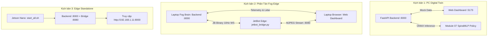

# CS532 — AUTONOMOUS JETBOT NAVIGATION & PERCEPTION SYSTEM
### HỆ THỐNG ĐIỀU HƯỚNG TỰ HÀNH & NÉ VẬT CẢN JETBOT ĐA TẦNG (2026)

---

## 📌 1. Giới Thiệu Tổng Quan (Project Overview)

Đồ án **CS532** phát triển hệ thống robot tự hành thông minh trên nền tảng **NVIDIA JetBot** (Jetson Nano) kết hợp cảm biến **LiDAR D500** (quét 360° UART 230400 baud) và **Camera CSI IMX219** (góc rộng 160° FOV).

Hệ thống được thiết kế theo kiến trúc **Fog-Edge Decoupled Computing**:
* **Edge Node (JetBot - Jetson Nano `192.168.1.11`):** Chạy `03-MinhHieu/jetbot_bridge.py` đọc cảm biến phần cứng thời gian thực, phát luồng video native MJPEG (cổng `:8080`), đóng gói dữ liệu LiDAR qua giao thức nhị phân siêu nhẹ **JB-Binary Protocol** (1,130 bytes @ 10Hz), kiểm soát vùng chết động cơ GA25 và kích hoạt phản xạ an toàn cục bộ (Emergency Reflex Shield $< 14\text{cm}$).
* **Fog Brain (Laptop / Trạm điều khiển trung tâm):** Xử lý thuật toán điều hướng cấp cao gồm 2 cơ chế song song:
  1. **Chính sách Học máy Imitation Learning (Primary):** Mạng nơ-ron **SpiralMLP** (Mu et al., arXiv:2404.00648v2) & thuật toán **DAgger** (Ross et al., 2011) triệt tiêu Covariate Shift, chạy trên nhân suy luận **ONNX Runtime** siêu tốc độ trễ $< 0.05\text{ms}$.
  2. **Quy hoạch Cổ điển C-Core (Fallback):** Nhân A* C-core tối ưu (`astar_core.c` $< 0.2\text{ms}$), gom cụm 1D Range Jump, né cản hình thang Plateau Detour, điều tốc vào cua Curvature Scaling và điều khiển bám đường Pure Pursuit.
* **Web Dashboard visionOS:** Giao diện điều khiển kính mờ Apple visionOS glassmorphism xây dựng trên React 19 + TypeScript + Vite + Tailwind CSS, đồng bộ telemetry 10Hz qua WebSocket.

---

## 📂 2. Cấu Trúc Dự Án (Repository Structure)

Dự án được phân rã thành **các module độc lập** theo nguyên tắc **Một tính năng / Một gói phần mềm** nhằm tối ưu hóa quy trình kiểm thử PC-First và tránh xung đột mã nguồn:

```text
CS532/
├── 01-HieuMe/               # [THỊ GIÁC MÁY TÍNH & BÙ ĐIỂM MÙ LIDAR]
│   ├── config/              # Cấu hình camera, 4 điểm hiệu chuẩn Homography IPM & Safety Margins
│   ├── core/                # Thuật toán cốt lõi: FrameGrabber, FloorIPM, YoloDetector, Proxemics
│   ├── models/              # Trọng số YOLO26-n ONNX/PT & Hướng dẫn build TensorRT FP16 .engine
│   ├── sample_data/         # Ảnh chụp thực tế từ camera CSI JetBot để kiểm thử
│   ├── pipeline.py          # Pipeline hoàn chỉnh End-to-End: Frame -> Detections + IPM -> JSON
│   ├── test_cv_pipeline.py  # Bộ kiểm thử độc lập 5/5 bài test (Pass 100% không cần phần cứng)
│   └── requirements.txt     # Thư viện phụ thuộc (opencv-python, numpy, onnxruntime)
│
├── 02-DuyHieu/              # [ĐIỀU HƯỚNG C-CORE & BỘ SINH QUỸ ĐẠO CHUYÊN GIA]
│   ├── planning/            # Nhân thuật toán A* tối ưu bằng C (astar_core.c < 0.2ms)
│   ├── controller.py        # Curvature Velocity Scaling & Plateau Detour Splicing
│   ├── test_planning_local.py # Script kiểm thử A* và né cản cục bộ trên PC (4/4 PASS)
│   └── verify_step1_astar.py # Thẩm định hình học và đo đạc độ trễ A* (3/3 PASS)
│
├── 03-MinhHieu/             # [GIAO DIỆN WEB VISIONOS & BACKEND ĐIỀU PHỐI]
│   ├── frontend/            # Web Dashboard Apple visionOS glassmorphism (React 19 + Vite + Tailwind CSS)
│   ├── backend/             # Server điều phối FastAPI, WebSocket 10Hz, ONNX Bridge & Telemetry Parser
│   │   ├── app/
│   │   │   ├── api/         # REST API endpoints & route handlers
│   │   │   ├── hardware/    # Client nhận dữ liệu JB-Binary từ JetBot
│   │   │   ├── navigation/  # Điều phối điều hướng: coordinator.py, il_onnx_bridge.py, motion_adapter.py
│   │   │   ├── simulation/  # Mock arena giả lập môi trường vật lý trên PC
│   │   │   ├── streaming/   # Hub WebSocket broadcaster & MJPEG video streamer
│   │   │   └── config.py    # Cấu hình tần số, giới hạn bản đồ, tham số xe
│   │   ├── run.py           # Entrypoint chính khởi động Backend Server
│   │   └── requirements.txt # Thư viện phụ thuộc Backend (fastapi, uvicorn, websockets, pydantic)
│   ├── jetbot_bridge.py     # Cầu nối phần cứng Edge (LiDAR D500, Camera CSI, Động cơ GA25, Mux 50Hz)
│   ├── start_all.sh         # Script khởi động đồng bộ toàn bộ hệ thống trên Jetson Nano
│   └── stop_all.sh          # Script dừng an toàn toàn bộ tiến trình
│
├── 05-d500lib-motion/       # [SLAM, ODOMETRY & ĐỘNG LỰC HỌC XE THẬT]
│   ├── d500_driver.py       # Driver LiDAR LDROBOT D500 chuẩn bảng tra CRC-8 & Revolution Sync
│   ├── planning/            # Tầng quy hoạch: Likelihood Field SLAM, Lever-Arm Odometry, Kinodynamic RVO
│   │   ├── il/              # Mẫu thử nghiệm DAgger sơ khởi (test_dagger_policy.py)
│   │   └── slam/            # Multi-layer Decoupled Costmap (Static Anchor, Rolling, Cluster, Low-Obs)
│   └── robot_dynamics.json  # Cấu hình động học xe thật (tốc độ, deadband động cơ GA25-370)
│
├── 06-cartographer/         # [CARTOGRAPHER 2D SLAM & ROS 2 BRIDGE]
│   ├── cartographer_core/   # Pipeline thuần Python: Odds ProbabilityGrid, CSM, Submap2D, PoseGraph2D
│   ├── config/              # Cấu hình Cartographer 2D LUA (REP-103/REP-105 TF Tree)
│   └── scripts/             # Bridge kết nối ROS 2 và Web Dashboard
│
├── 07-imitation-learning/   # [AI NÉ VẬT CẢN: SPIRALMLP + DAGGER IMITATION LEARNING]
│   ├── config.py            # Không gian trạng thái 41D, siêu tham số SpiralMLP & DAgger
│   ├── dataset.py           # Pipeline xử lý dữ liệu, chuẩn hóa & Bilateral Symmetry Augmentation
│   ├── spiral_nav_policy.py # Kiến trúc SpiralMLP (Mu et al. arXiv:2404.00648v2) & Export ONNX
│   ├── model.py             # Policy MLP baseline, Pure NumPy Engine & ONNX Runtime Runner
│   ├── mock_expert_simulator.py # Giả lập 2D Raycaster + Chuyên gia hình học giải tích (DDE Oracle)
│   ├── data_collector.py    # Thu thập dữ liệu chuyên gia kèm tiêm nhiễu ngẫu nhiên DART
│   ├── train_bc.py          # Huấn luyện Behavioral Cloning (Weighted MSE, AdamW, Cosine LR)
│   ├── dagger_session.py    # Vòng lặp DAgger triệt tiêu Covariate Shift & xuất mô hình ONNX
│   ├── il_policy_runner.py  # Bộ điều phối thời gian thực (Safety Shield < 14cm + Motor Deadband)
│   ├── bridge_il_adapter.py # Cầu nối tích hợp trực tiếp vào jetbot_bridge.py / Coordinator
│   ├── benchmark_onnx.py    # Thẩm định cấu trúc đồ thị ONNX & Benchmark độ trễ (< 0.05ms)
│   ├── evaluate_benchmark.py # Đánh giá tỷ lệ thành công, va chạm và thời gian về đích
│   ├── live_evaluator.py    # Hộp đen máy bay đánh giá trực tiếp qua WebSocket `:8000`
│   └── test_il_pipeline.py  # Bộ kiểm thử tự động toàn diện Module 07
│
├── agents-doc/              # [TÀI LIỆU KIẾN TRÚC & QUẢN TRỊ DỰ ÁN]
│   ├── STATE.md             # Nguồn sự thật duy nhất (Single Source of Truth) ghi lại trạng thái hệ thống
│   ├── TICKETS.md           # Hệ thống phiếu công việc và tiêu chuẩn nghiệm thu (Definition of Done)
│   ├── README.md            # Tổng quan về kiến trúc và phân công vai trò tác nhân
│   └── agents/              # Đặc tả 4 Core Agents (Lead Supervisor, AI Learning, Researcher, Auditor)
│
├── scripts/                 # [KIỂM ĐỊNH TOÀN VẸN TỰ ĐỘNG]
│   └── verify_agent_integrity.py # Quét AST tĩnh 100% cú pháp Python & thẩm định đường dẫn thật
│
├── setup/                   # [CẤU HÌNH & HIỆU CHUẨN PHẦN CỨNG XE THẬT]
│   ├── robot_dynamics.json  # Single Source of Truth thông số động lực học xe
│   └── test_lidar.py        # Đo đạc tần số quét, la bàn 4 hướng & kiểm tra hướng góc 0° LiDAR
│
├── teleop_gamepad.py        # [ĐIỀU KHIỂN TAY CẦM / BÀN PHÍM THỜI GIAN THỰC]
│   └── Điều khiển JetBot bằng Gamepad (Xbox, PS4/PS5, Logitech) hoặc bàn phím kèm Watchdog
│
├── .env.example             # Mẫu cấu hình biến môi trường
└── README.md                # Tài liệu hướng dẫn toàn diện dự án
```

---

## 🛠️ 3. Yêu Cầu Môi Trường & Cài Đặt (Prerequisites & Setup)

### 3.1. Yêu cầu hệ thống
* **Hệ điều hành:** Windows 10/11, Ubuntu 20.04/22.04 LTS, hoặc NVIDIA JetPack 4.6.x (Ubuntu 18.04 aarch64 trên Jetson Nano).
* **Python:** Phiên bản `3.8+` đến `3.14+`.
* **Node.js & npm:** Phiên bản `Node.js 18+` (hoặc `20+ LTS`) dùng cho Web Dashboard.

### 3.2. Cài đặt môi trường Python (Trên PC / Laptop)
```bash
# Tạo và kích hoạt môi trường ảo (khuyến nghị)
python -m venv .venv

# Trên Windows (PowerShell):
.venv\Scripts\Activate.ps1
# Trên Linux / macOS:
source .venv/bin/activate

# Cài đặt thư viện Backend điều phối:
pip install fastapi uvicorn websockets pydantic

# Cài đặt thư viện Thị giác máy tính & AI Imitation Learning:
pip install numpy opencv-python onnx onnxruntime torch
```

### 3.3. Cài đặt Web Dashboard Frontend (Node.js)
```bash
cd 03-MinhHieu/frontend
npm install
cd ../..
```

---

## 🚀 4. Hướng Dẫn Chạy Hệ Thống Theo Từng Kịch Bản (Execution Scenarios)

Hệ thống hỗ trợ **5 kịch bản vận hành chính**, từ kiểm thử hoàn toàn trên PC (không cần phần cứng) đến vận hành phân tán Fog-Edge và chạy độc lập trên JetBot thật:



---

### 🟢 KỊCH BẢN 1: Chạy Giả Lập Hoàn Toàn Trên PC (PC-First Digital Twin)

Dành cho nhà phát triển muốn thử nghiệm toàn bộ hệ thống điều hướng, bản đồ và giao diện web trên máy tính mà **không cần kết nối robot thật**.

1. **Bước 1: Khởi động Backend Server (Bộ não điều phối)**
   ```bash
   cd 03-MinhHieu/backend
   python run.py --host 0.0.0.0 --port 8000
   ```
   *(Backend sẽ tự động kích hoạt chế độ giả lập Mock Arena, tạo ra 5 vật cản hình tròn, tường phòng ảo, và nạp mô hình nơ-ron tự hành ONNX).*

2. **Bước 2: Khởi động Web Dashboard Frontend**
   Mở terminal thứ hai:
   ```bash
   cd 03-MinhHieu/frontend
   npm run dev
   ```

3. **Bước 3: Trải nghiệm trên trình duyệt**
   * Truy cập Web Dashboard: [http://localhost:5173](http://localhost:5173)
   * Tài liệu API tương tác Swagger: [http://localhost:8000/docs](http://localhost:8000/docs)
   * Luồng video camera giả lập: [http://localhost:8000/video_feed](http://localhost:8000/video_feed)
   * Nhấp chuột trên bản đồ để đặt mục tiêu **Target Goal**, robot sẽ tự động né cản theo chính sách SpiralMLP ONNX!

4. **Tùy biến chế độ điều hướng qua biến môi trường:**
   * Dùng mạng nơ-ron Imitation Learning (mặc định):
     ```bash
     # Windows PowerShell:
     $env:USE_IL_NAVIGATION="1"; python run.py
     # Linux / Bash:
     USE_IL_NAVIGATION=1 python run.py
     ```
   * Chuyển về quy hoạch cổ điển A* C-core + Pure Pursuit:
     ```bash
     USE_IL_NAVIGATION=0 python run.py
     ```
   * Thay đổi kiểu không gian sa bàn:
     ```bash
     # Mặc định: "ROOM" (phòng mở, không giới hạn tường ảo)
     # "ARENA_2X1": sa bàn 2m x 1m
     # "SEMINAR_5X5": phòng báo cáo 5m x 5m
     ENVIRONMENT_MODE=ARENA_2X1 python run.py
     ```

---

### 🟡 KỊCH BẢN 2: Vận Hành Phân Tán Fog-Edge (Laptop Fog Brain + JetBot Edge)

Dành cho thực nghiệm thực tế trên sa bàn: Laptop chịu tải tính toán AI/SLAM nặng, JetBot chỉ đóng vai trò thu thập cảm biến và phát lệnh động cơ.

1. **Bước 1: Khởi động Fog Brain trên Laptop**
   * Xác định địa chỉ IP mạng Wi-Fi của Laptop (ví dụ: `192.168.1.100`).
   * Khởi động Backend và Frontend trên Laptop:
     ```bash
     # Terminal 1 - Backend:
     cd 03-MinhHieu/backend
     python run.py --host 0.0.0.0 --port 8000

     # Terminal 2 - Frontend:
     cd 03-MinhHieu/frontend
     npm run dev
     ```

2. **Bước 2: Kết nối JetBot thật qua SSH**
   * Đăng nhập vào Jetson Nano:
     ```bash
     ssh jetbot@192.168.1.11
     ```
   * Khởi động cầu nối phần cứng, truyền trực tiếp IP của Laptop:
     ```bash
     cd ~/CS532/03-MinhHieu
     python3 jetbot_bridge.py 192.168.1.100
     ```
   * `jetbot_bridge.py` sẽ tự động:
     * Mở cổng UART kết nối LiDAR D500 (230400 baud, 360 tia).
     * Mở Camera CSI IMX219 native MJPEG server tại cổng `:8080`.
     * Đóng gói khung nhị phân JB-Binary (1,130 bytes @ 10Hz) bắn qua WebSocket `ws://192.168.1.100:8000/ws/robot`.
     * Kích hoạt lá chắn phanh khẩn cấp phần cứng $< 14\text{cm}$.

3. **Bước 3: Giám sát và Điều khiển**
   * Mở trình duyệt trên Laptop: [http://localhost:5173](http://localhost:5173).
   * Bạn sẽ thấy tia LiDAR thời gian thực quét môi trường phòng thật, luồng camera CSI trực tiếp, và trạng thái pin INA219.

---

### 🔵 KỊCH BẢN 3: Chạy Độc Lập Trực Tiếp Trên Xe (Edge Standalone trên Jetson Nano)

Dành cho kịch bản xe tự hành hoàn toàn, tự chứa cả Backend lẫn Web Server trên Jetson Nano mà không phụ thuộc Laptop.

1. **Build bản phân phối tĩnh Frontend (chỉ cần làm 1 lần trên máy tính hoặc JetBot):**
   ```bash
   cd 03-MinhHieu/frontend
   npm run build
   ```
   *(Thư mục `dist/` tạo ra sẽ được FastAPI tự động mount và phục vụ tại đường dẫn gốc `/`).*

2. **Khởi động trọn bộ bằng một câu lệnh:**
   ```bash
   cd 03-MinhHieu
   bash start_all.sh
   ```
   * Toàn bộ hệ thống Backend `:8000` và `jetbot_bridge.py` sẽ chạy ngầm qua `nohup`.
   * Xem log thời gian thực:
     ```bash
     tail -f 03-MinhHieu/backend/server.log
     tail -f 03-MinhHieu/bridge.log
     ```
   * Truy cập giao diện điều khiển từ điện thoại / máy tính bảng bất kỳ trong mạng:
     `http://192.168.1.11:8000`

3. **Dừng hệ thống an toàn:**
   ```bash
   cd 03-MinhHieu
   bash stop_all.sh
   ```

---

### 🟣 KỊCH BẢN 4: Huấn Luyện & Đánh Giá AI Imitation Learning (`07-imitation-learning/`)

Quy trình khép kín phát triển mô hình nơ-ron tự hành né vật cản theo lý thuyết **UIT RL-101 (Bài 10: Học bắt chước)**:

1. **Bước 4.1: Thu thập tập dữ liệu chuyên gia mô phỏng (kèm tiêm nhiễu DART)**
   ```bash
   python 07-imitation-learning/data_collector.py --episodes 50 --output 07-imitation-learning/data/expert_demonstrations.npz
   ```
   * Thu thập 50 kịch bản ngẫu nhiên.
   * Cơ chế **DART (Data Gathering with Asserted Random Trajectories)** tự động tiêm nhiễu ngẫu nhiên khi an toàn để buộc chuyên gia sinh hành vi tự sửa sai (recovery behavior).
   * Tự động nhân đôi tập mẫu nhờ tăng cường đối xứng song phương (Bilateral Symmetry Augmentation).

2. **Bước 4.2: Huấn luyện mô hình Behavioral Cloning (BC) cơ sở**
   ```bash
   python 07-imitation-learning/train_bc.py --data 07-imitation-learning/data/expert_demonstrations.npz --save-dir 07-imitation-learning/models --epochs 80 --batch-size 64
   ```
   * Sử dụng hàm mất mát có trọng số: $w_v = 1.0$ (vận tốc dài) và $w_\omega = 1.5$ (bẻ lái né cản).
   * Tự động xuất ra:
     * Checkpoint PyTorch: `models/bc_policy_best.pt`
     * Trọng số thuần NumPy: `models/bc_policy_numpy.json`
     * Mô hình chuẩn công nghiệp: `models/bc_policy.onnx`

3. **Bước 4.3: Huấn luyện DAgger triệt tiêu lỗi trôi phân phối (Covariate Shift)**
   ```bash
   python 07-imitation-learning/dagger_session.py --data 07-imitation-learning/data/expert_demonstrations.npz --save-dir 07-imitation-learning/models --iterations 5
   ```
   * Chạy qua 5 vòng lặp DAgger với hệ số hòa trộn $\beta_k = 0.5^k$.
   * Robot tự điều khiển, chuyên gia gán nhãn trạng thái lạ, kéo giảm sai số tích lũy từ $O(T^2\epsilon) \to O(T\epsilon)$.
   * Xuất mô hình tối ưu cuối cùng: `models/dagger_policy.onnx`.

4. **Bước 4.4: Kiểm định đồ thị ONNX & Đo đạc tốc độ suy luận (Benchmark)**
   ```bash
   python 07-imitation-learning/benchmark_onnx.py --model 07-imitation-learning/models/dagger_policy.onnx --runs 5000
   ```
   * Đo đạc độ trễ suy luận ONNX Runtime: **$< 0.05\text{ ms}$ (đạt $> 40,000$ lượt suy luận/giây)**, đáp ứng vượt trội chu kỳ 10Hz của LiDAR.

5. **Bước 4.5: Đánh giá định lượng hiệu năng né cản (Evaluation Benchmark)**
   ```bash
   python 07-imitation-learning/evaluate_benchmark.py --model 07-imitation-learning/models/dagger_policy.onnx --episodes 30
   ```
   * Đánh giá tỷ lệ về đích thành công (Success Rate $> 80\%$), tỷ lệ va chạm (Collision Rate $< 5\%$), và xuất báo cáo JSON chi tiết tại `07-imitation-learning/logs/`.

6. **Bước 4.6: Chạy hộp đen đánh giá trực tiếp (Live Flight Recorder)**
   Kết nối trực tiếp tới Backend đang chạy để điều khiển xe và ghi log viễn trắc telemetry:
   ```bash
   python 07-imitation-learning/live_evaluator.py --host 127.0.0.1 --port 8000 --model 07-imitation-learning/models/dagger_policy.onnx --goal-x 1.8 --goal-y 0.0
   ```

---

### 🎮 KỊCH BẢN 5: Điều Khiển Bằng Tay Cầm / Bàn Phím (`teleop_gamepad.py`)

Hỗ trợ điều khiển xe JetBot trực tiếp với cơ chế **Safety Watchdog** tự động phanh khi nhả cần hoặc mất kết nối:

```bash
# 1. Chế độ tự động nhận diện tay cầm USB / Bluetooth (Xbox, PS4/PS5, Logitech F710):
python teleop_gamepad.py

# 2. Chế độ điều khiển dự phòng bằng bàn phím (không cần tay cầm):
python teleop_gamepad.py --keyboard
```
* **Bảng phím điều khiển:**
  * `W` / `Mũi tên lên`: Tiến thẳng.
  * `S` / `Mũi tên xuống`: Lùi xe.
  * `A` / `Mũi tên trái`: Quay trái tại chỗ.
  * `D` / `Mũi tên phải`: Quay phải tại chỗ.
  * `Space` hoặc `X`: Dừng xe khẩn cấp (`robot.stop()`).
  * `+` / `-`: Tăng / Giảm cấp số tốc độ (15% -> 40%).
  * `Q`: Thoát chương trình.

---

## 🧪 5. Kiểm Thử Độc Lập Các Module (Modular Unit Testing)

Tất cả các bài kiểm thử đều tuân thủ triết lý **PC-First & Zero-Hallucination**, có thể chạy độc lập ngay trên máy tính mà không cần phần cứng:

### 5.1. Thẩm Định Toàn Vẹn Mã Nguồn Toàn Dự Án
```bash
python scripts/verify_agent_integrity.py
```
*(Quét cú pháp AST 100% các tệp Python và thẩm định 100% đường dẫn trong tài liệu kiến trúc. Yêu cầu: PASS 100%).*

### 5.2. Module Thị Giác Máy Tính (`01-HieuMe/`)
```bash
# Chạy bộ Unit Test thị giác độc lập (5/5 PASS):
python 01-HieuMe/test_cv_pipeline.py

# Chạy thử nghiệm Pipeline với ảnh tĩnh mẫu:
python 01-HieuMe/pipeline.py -s 01-HieuMe/sample_data/csi_floor_sample.jpg

# Chạy với luồng camera MJPEG từ JetBot thật:
python 01-HieuMe/pipeline.py -s "http://192.168.1.11:8080/api/stream/mjpeg"
```

### 5.3. Module Tìm Đường C-Core (`02-DuyHieu/`)
```bash
cd 02-DuyHieu
python test_planning_local.py   # Kiểm tra 4/4 tiêu chí kỹ thuật: Grid, 1D Jump, Plateau, Curvature Scaling
python verify_step1_astar.py     # Đo đạc độ trễ thuật toán A* (P95 < 1.05ms)
cd ..
```

### 5.4. Module SLAM & DAgger Prototype (`05-d500lib-motion/`)
```bash
cd 05-d500lib-motion/planning/il
python test_dagger_policy.py    # Kiểm tra chính sách DAgger 8/8 PASS
cd ../../..
```

### 5.5. Module AI Imitation Learning (`07-imitation-learning/`)
```bash
python 07-imitation-learning/test_il_pipeline.py
```

### 5.6. Hiệu Chuẩn & Kiểm Tra Phần Cứng LiDAR (`setup/test_lidar.py`)
Khi kết nối với LiDAR D500 qua cáp USB-UART trên Jetson Nano:
```bash
python setup/test_lidar.py
```
* Menu kiểm tra:
  * `[1]` La bàn khoảng cách thời gian thực 4 hướng (Trước, Phải, Sau, Trái).
  * `[2]` Kiểm tra hướng gắn góc 0° của LiDAR (tự động phát hiện nếu bị gắn ngược 180°).
  * `[3]` Thử nghiệm phản xạ phanh khẩn cấp ($< 20\text{cm}$ ngắt ga).

---

## ⚙️ 6. Bảng Tra Cứu Biến Môi Trường (Environment Variables)

Các biến môi trường có thể cấu hình thông qua tệp `.env` hoặc truyền trực tiếp trước lệnh chạy:

| Biến môi trường | Giá trị mặc định | Mô tả ý nghĩa |
|---|---|---|
| `USE_IL_NAVIGATION` | `"1"` | `1`: Sử dụng mạng nơ-ron Imitation Learning (ONNX) để né cản; `0`: Dùng A* C-core cổ điển. |
| `ENVIRONMENT_MODE` | `"ROOM"` | Kiểu không gian sa bàn: `"ROOM"` (phòng mở thực tế), `"ARENA_2X1"` (sa bàn 2m x 1m), `"SEMINAR_5X5"` (phòng 5m x 5m). |
| `AUTO_START_BRIDGE` | `"0"` | `1`: Backend tự động gọi `jetbot_bridge.py` cục bộ; `0`: Chạy độc lập / phân tán (khuyến nghị). |
| `ROBOT_IP` | `192.168.1.11` | Địa chỉ IP của JetBot trên mạng Wi-Fi cục bộ. |
| `LIDAR_PORT` | `/dev/ttyUSB0` | Cổng giao tiếp UART của LiDAR D500 trên Jetson Nano (hoặc `/dev/ttyTHS1`). |
| `LIDAR_BAUDRATE` | `230400` | Tốc độ baud chuẩn của LDROBOT D500. |

---

## 📡 7. Hợp Đồng Dữ Liệu Tích Hợp (Data Contracts)

### 7.1. Giao Thức Nhị Phân JB-Binary v1.0 (Edge JetBot $\to$ Fog Brain)
* Kích thước khung cố định: **1,130 bytes** (`Header 18B` + `LiDAR 360 tia 720B` + `Intensities 360B` + `Telemetry 32B`).
* Tần số truyền tải: **10Hz qua WebSocket**, tiết kiệm $93\%$ băng thông so với JSON thô, độ trễ $< 15\text{ms}$.

### 7.2. Dữ Liệu Thị Giác (`01-HieuMe` $\to$ Planning / Dashboard)
```json
{
  "timestamp": 1727500000.150,
  "frame_id": 142,
  "detections": [
    {
      "class_id": 0,
      "class_name": "person",
      "confidence": 0.88,
      "azimuth_deg": 14.5,
      "distance": 1.25,
      "safety_margin_m": 0.77,
      "bbox": [200, 150, 320, 420]
    }
  ],
  "low_obstacles": [
    [0.45, 0.08],
    [0.55, -0.12]
  ],
  "social_bubbles": [
    {
      "x": 1.21,
      "y": 0.31,
      "radius_m": 0.77,
      "azimuth_deg": 14.5,
      "distance_m": 1.25
    }
  ],
  "latency_ms": 14.2
}
```

---

## 🔒 8. Quy Ước Kỷ Luật Mã Nguồn (Repository Rules)

1. **Ranh giới module:** Mỗi thành viên phát triển trong thư mục chuyên trách (`01-HieuMe/`, `02-DuyHieu/`, `03-MinhHieu/`, `05-d500lib-motion/`, `07-imitation-learning/`).
2. **Kiểm tra trước khi commit:** Bắt buộc chạy pass bộ unit test của module và script `scripts/verify_agent_integrity.py`.
3. **Bảo mật & Tối ưu:** Tuyệt đối không commit tệp nhị phân nặng (`.engine`, `node_modules`, `__pycache__`) hoặc secret/API key.
4. **Quy chuẩn điều khiển xe thật:** Mọi thuật toán phải tuân thủ nghiêm ngặt các giới hạn an toàn trong [setup/robot_dynamics.json](setup/robot_dynamics.json):
   * Vận tốc dài an toàn: $v \le 0.14\text{ m/s}$ (Deadband tối thiểu: $v_{min} \ge 0.12\text{ m/s}$ để thắng ma sát tĩnh hộp số GA25).
   * Vận tốc góc an toàn: $|\omega| \le 0.35\text{ rad/s}$ ($\approx 20^\circ/\text{s}$, chống văng trượt bánh trên sàn gạch men bóng).
   * Gia tốc ly tâm giới hạn: $|v \cdot \omega| \le 0.176\text{ m/s}^2$.
