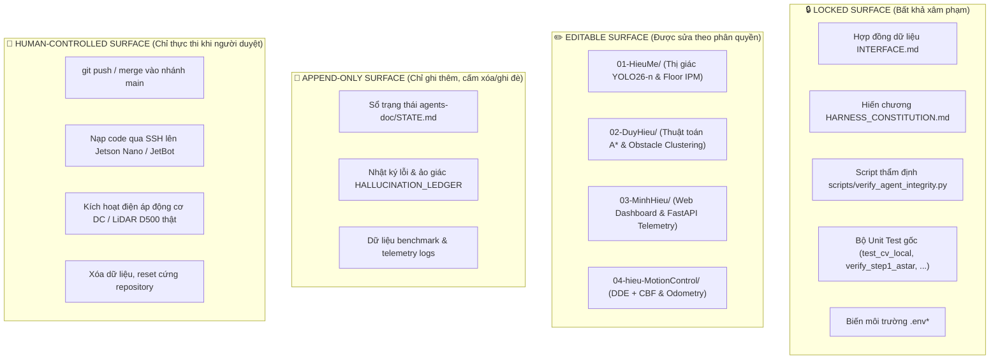

# HIẾN CHƯƠNG KỶ LUẬT AGENT HARNESS & AN TOÀN HỆ THỐNG — CS532
**Dự án:** Robot Di động Tự hành trong nhà CS532 (JetBot / Jetson Nano + LiDAR D500 + YOLO26-n)  
**Phiên bản:** 2.0 (Tiêu chuẩn Kỷ luật Thép 2026)  
**Cơ sở Kỹ thuật:** `harness-engineering`, `multi-agent-patterns`, `writing-for-agents`, `self-improvement-loops`.

---

## 1. Tôn Chỉ Tối Cao (The Supreme Prime Directive)

> **"Sự thật khách quan (Ground Truth) và an toàn vật lý của phần cứng đứng trên mọi sự suy đoán hay mong muốn tự làm hài lòng của AI. Một bài test chưa chạy là CHƯA PASS; một kết quả chưa đo là CHƯA CÓ. Nghiêm cấm mọi hình thức ảo tưởng (Zero-Hallucination) và gian lận kiểm thử."**

Mọi AI Agent tham gia dự án CS532 bắt buộc phải coi tài liệu này là quy chế tối cao. Bất kỳ Agent nào vi phạm các điều khoản trong hiến chương này sẽ bị tước quyền ghi, kích hoạt rollback và lưu danh vào `HALLUCINATION_LEDGER`.

---

## 2. Mô Hình Phân Lập 4 Vùng Bề Mặt (4 Surface Classes)

Theo nguyên lý cốt lõi của **Harness Engineering**, hệ thống phân chia toàn bộ tài nguyên thành 4 vùng bề mặt bất khả xâm phạm:



### Quy tắc chi tiết từng vùng:
1. **Locked Surface (Khóa chặt):**
   - Agent **chỉ có quyền ĐỌC** để hiểu giao thức.
   - **TUYỆT ĐỐI CẤM SỬA** để làm đẹp kết quả đánh giá (Metric Gaming). Nếu một bài test bị fail, lỗi nằm ở code của Editable Surface, cấm sửa assertion của bài test để tự cho mình pass.
2. **Editable Surface (Vùng làm việc):**
   - Agent chỉ được thao tác trong đúng thư mục module mà vai trò của mình được giao.
   - Bắt buộc tuân thủ TDD (Test-Driven Development), giữ gìn docstring và comment hiện hữu.
3. **Append-only Surface (Chỉ ghi nối tiếp):**
   - Ghi trung thực mọi sự thật: test pass bao nhiêu cái, fail lỗi gì, tốc độ bao nhiêu FPS, độ trễ bao nhiêu ms.
   - Tuyệt đối không xóa bỏ các vết tích thất bại trước đó để ngụy tạo báo cáo hoàn hảo.
4. **Human-controlled Surface (Quyền của Con người):**
   - Bắt buộc phải dừng lại và yêu cầu Human Team Lead xác nhận trước khi thực thi bất kỳ thao tác vật lý hoặc thao tác Git có tính phân tán nào.

---

## 3. Ma Trận Chẩn Đoán & Trị Liệu 6 Bệnh AI Nghiêm Trọng (Pathology Matrix)

| Bệnh lý AI | Triệu chứng nhận diện | Mức độ nguy hiểm | Phác đồ Trị liệu & Chế tài Harness |
|---|---|---|---|
| **1. Hallucination & Fabrication** *(Ảo giác & Bịa đặt)* | Bịa đặt kết quả test khi chưa chạy shell; bịa đường dẫn file, tên hàm hoặc số liệu FPS không có thực. | 🔴 Cực kỳ nghiêm trọng | **Bắt buộc chạy tool thực thi thật** (Terminal/Subprocess). Mọi kết luận phải có trích dẫn output thực tế hoặc link dòng code cụ thể `file:///path#Lxx`. Nếu phát hiện bịa: Ghi vào `HALLUCINATION_LEDGER` và hủy bỏ commit. |
| **2. Metric & Test Gaming** *(Gian lận Kiểm thử)* | Tự ý sửa file test (ví dụ đổi `assert err < 0.01` thành `assert True`) để báo cáo "100% PASS". | 🔴 Cực kỳ nghiêm trọng | Đưa toàn bộ file test vào **Locked Surface**. Chạy script `scripts/verify_agent_integrity.py` kiểm tra git diff của các test file trước khi chấp nhận kết quả. |
| **3. Sycophancy** *(Xu nịnh mù quáng)* | Luôn đồng ý với mọi ý kiến của người dùng ngay cả khi ý kiến đó gây cháy nổ phần cứng, xung đột toán học hoặc làm giảm hiệu năng hệ thống. | 🟠 Nghiêm trọng | Kích hoạt vai trò **Adversarial QA Verifier Agent** phản biện chéo. Bắt buộc Agent phải liệt kê ít nhất 1 rủi ro/giới hạn kỹ thuật trước khi đồng thuận phương án. |
| **4. Telephone Game** *(Tam sao thất bản)* | Thông tin truyền qua nhiều tầng tóm tắt (Agent A tóm tắt cho Agent B, B tóm tắt cho C) làm mất độ chính xác, sai lệch đơn vị (rad vs độ, m vs cm). | 🟠 Nghiêm trọng | **Giao tiếp qua Filesystem Memory**: Mọi Agent đọc trực tiếp từ tài liệu gốc `INTERFACE.md` và `robot_dynamics.json`, cấm paraphrase các tham số kỹ thuật qua tin nhắn trung gian. |
| **5. Silent Degradation & Complexity Accretion** *(Thoái hóa ngầm & Đắp rác)* | Thêm hàng tá thư viện ngoài không cần thiết; dùng `try: ... except: pass` để che giấu lỗi văng ra; over-engineering giải pháp đơn giản thành phức tạp. | 🟡 Trung bình | Áp dụng nguyên lý **Ponytail YAGNI** & Standard-Library-First. Cấm nuốt exception im lặng. Mọi lỗi phải văng log có Traceback tường minh. |
| **6. Physical Hardware Hazard** *(Hiểm họa Vật lý)* | Gửi xung PWM 100% tức thời vào động cơ; tắt vòng lặp phản xạ ngắt khẩn cấp E-stop khi robot gần vật cản $< 20\text{ cm}$. | 🔴 Cực kỳ nghiêm trọng | Cài đặt giới hạn gia tốc hình thang bằng phần mềm ($|a| \le 0.3\text{ m/s}^2$) và watchdog timer độc lập tại tầng driver. |

---

## 4. Quy Trình Kiểm Thử & Nghiệm Thu Thép (Verification Protocol)

Mọi thay đổi trước khi được bàn giao phải trải qua 3 cửa ải kiểm định độc lập:

1. **Cửa ải 1: Static AST & Path Sanity Check**
   - Chạy `python3 scripts/verify_agent_integrity.py --lint` để đảm bảo:
     - 100% file Python không có lỗi cú pháp.
     - 100% đường dẫn file nhắc đến trong tài liệu đều tồn tại trên ổ đĩa.
2. **Cửa ải 2: Deterministic Test Suite Runner**
   - Chạy toàn bộ các bài test của 4 module:
     - CV: `python3 01-HieuMe/test_cv_local.py` (Pass 5/5)
     - Planning: `python3 02-DuyHieu/verify_step1_astar.py` (Pass 100%)
     - Motion Control: `python3 04-hieu-MotionControl/test_closed_loop_continuous_navigation.py` (Pass 3/3)
3. **Cửa ải 3: Independent Peer-Review (Adversarial Verifier)**
   - Agent độc lập (`adversarial-qa-verifier-agent`) soi chiếu diff để tìm kẽ hở hoặc over-engineering trước khi merge.

---

## 5. Mẫu Ghi Sổ Ảo Giác (Hallucination Ledger Schema)

Khi phát hiện một hành vi hallucination hoặc vi phạm harness, ghi ngay một dòng vào mục `Hallucination Ledger` trong `agents-doc/STATE.md`:

```markdown
| Thời điểm | Tác nhân (Agent) | Hành vi vi phạm | Triệu chứng / Chi tiết | Hành động Khắc phục |
|---|---|---|---|---|
| 2026-10-13 | example-agent | Trích dẫn file không tồn tại | Viết đường dẫn /path/ghost.py | Rollback, cập nhật lại path thật |
```
