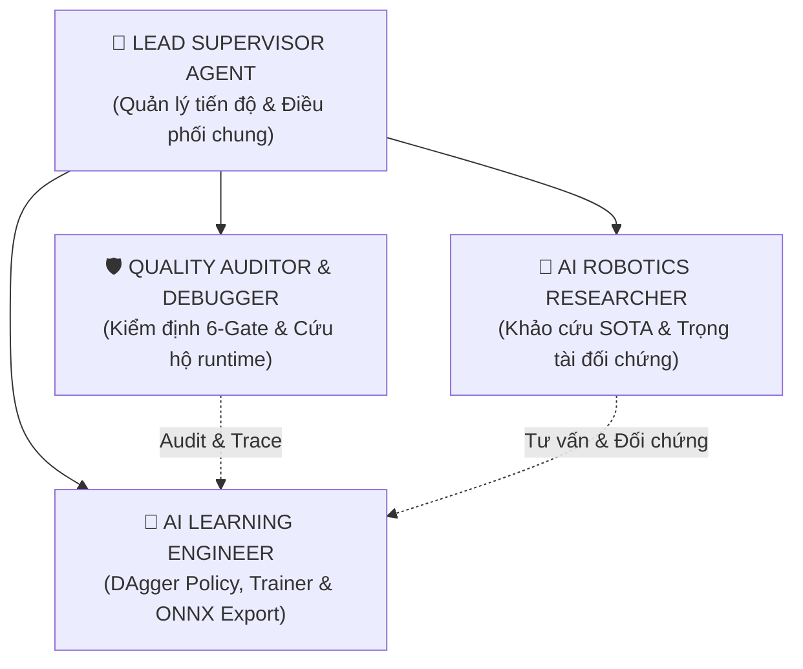

# 🧭 CS532 JETBOT AGENT HARNESS — HỆ ĐIỀU PHỐI TINH GỌN (CORE 4 AGENTS)

Chào mừng bạn đến với trung tâm tài liệu và cấu trúc điều phối AI Agent của đồ án **CS532 Autonomous JetBot (2026)**.  
Hệ thống được tinh gọn tối đa theo phong cách **ADHD-friendly / Anti-lecture** (nói ít làm nhiều, không dạy đời, tập trung số liệu và lệnh chạy thật).

---

## 1. Trạng Thái Dự Án Hiện Tại

- **Tầng SLAM & Odometry (Đã Đóng Băng 100%):**  
  - Likelihood Field SLAM, Lever-Arm Odometry bù tâm quay vi sai chống trượt sàn gạch.
  - Toàn bộ tài liệu pha SLAM được lưu trữ tại [`agents-doc/archive/slam-phase/`](file:///home/zxcvmh/Projects/CS532/agents-doc/archive/slam-phase).
- **Trọng Tâm Chiến Lược (Pha AI Navigation):**  
  - **Goal-Conditioned DAgger Imitation Learning** (`05-d500lib-motion/planning/il/`) thay thế sự phụ thuộc vào A*.
  - **CBF-QP Safety Shield** (`05-d500lib-motion/planning/cbf_safety_filter.py`) bảo đảm không va chạm vật lý ($< 0.15\text{m} \implies v=0$).
  - Policy suy luận thời gian thực $< 1.0\text{ms}$ trên CPU / $< 20\text{ms}$ trên Jetson Nano.

---

## 2. Đội Ngũ Tác Nhân Nòng Cốt (4 Core Agents)



| Agent | File cấu hình | Trách nhiệm chính |
|---|---|---|
| 👑 **Lead Supervisor** | [`lead-supervisor-agent.md`](file:///home/zxcvmh/Projects/CS532/agents-doc/agents/lead-supervisor-agent.md) | Quản lý tiến độ tổng thể, cập nhật `STATE.md` và `TICKETS.md`. |
| 🤖 **AI Learning Engineer** | [`ai-learning-engineer-agent.md`](file:///home/zxcvmh/Projects/CS532/agents-doc/agents/ai-learning-engineer-agent.md) | Huấn luyện DAgger (`dagger_trainer.py`), mô phỏng (`sim_env.py`), xuất ONNX/weights. |
| 🔬 **AI Robotics Researcher** | [`ai-robotics-researcher-agent.md`](file:///home/zxcvmh/Projects/CS532/agents-doc/agents/ai-robotics-researcher-agent.md) | Khảo cứu SOTA, trọng tài đối chứng độc lập khi có bất đồng quan điểm. |
| 🛡️ **Quality Auditor & Debugger** | [`quality-auditor-debugger-agent.md`](file:///home/zxcvmh/Projects/CS532/agents-doc/agents/quality-auditor-debugger-agent.md) | 6-Gate audit chống bẫy phần cứng, cứu hộ runtime (venv, I2C, UART, ports). |

---

## 3. Cấu Trúc Thư Mục Tinh Gọn

```text
agents-doc/
├── README.md               # File này: Tổng quan kiến trúc hệ thống Agent
├── STATE.md                # Bảng trạng thái living state & sổ lỗi HALLUCINATION_LEDGER
├── TICKETS.md              # Hệ thống phiếu công việc vi mô pha AI Learning
├── agents/                 # 4 Agent nòng cốt
│   ├── lead-supervisor-agent.md
│   ├── ai-learning-engineer-agent.md
│   ├── ai-robotics-researcher-agent.md
│   └── quality-auditor-debugger-agent.md
└── archive/                # Lưu trữ tài liệu lịch sử
    ├── deprecated/         # Các tài liệu cũ & agent phụ đã dọn dẹp
    └── slam-phase/         # Hồ sơ kỹ thuật pha SLAM đã hoàn tất
```

---

## 4. Kiểm Định Toàn Vẹn Tự Động

Mọi thay đổi trong tài liệu hoặc mã nguồn bắt buộc phải vượt qua:

```bash
.venv/bin/python scripts/verify_agent_integrity.py
```
- **100% file Python hợp lệ cú pháp AST.**
- **0 đường dẫn ma (Zero Ghost Paths).**
