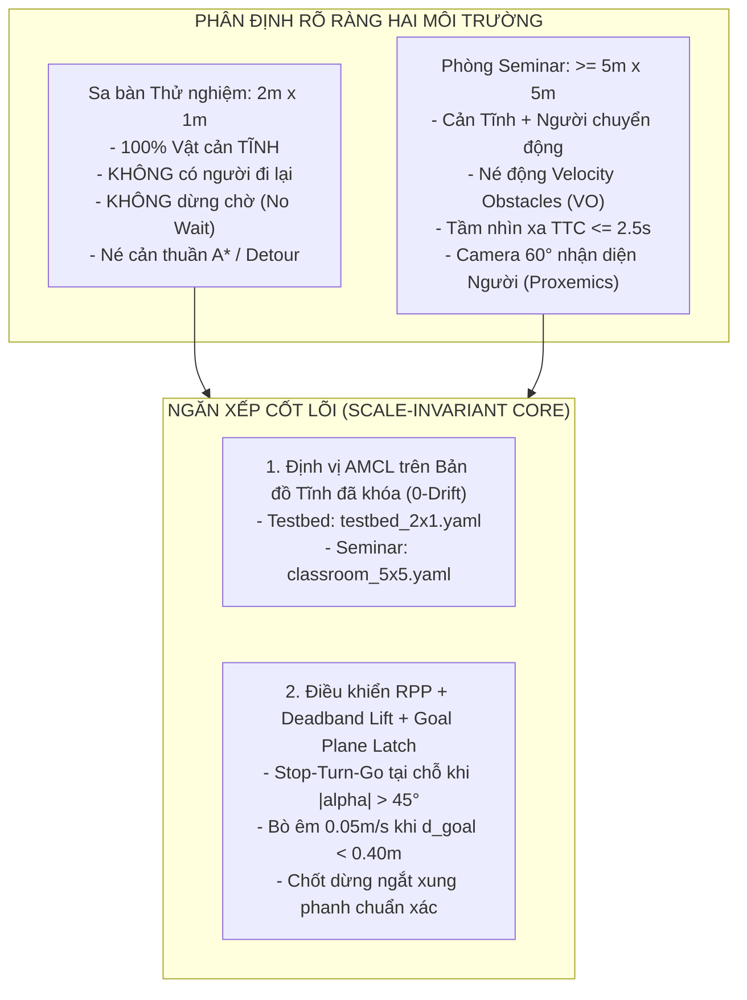

# 🎓 BÁO CÁO NGHIÊN CỨU & THIẾT KẾ ĐIỀU HƯỚNG TỰ HÀNH CHO JETBOT + D500 LIDAR
## TƯƠNG THÍCH ĐA QUY MÔ: TỪ SA BÀN TEST 2m×1m ĐẾN PHÒNG HỌC SEMINAR 5m×5m

**Dự án:** CS532 — Autonomous Mobile Robot  
**Nền tảng phần cứng:** NVIDIA JetBot AI Kit (GA25-370 DC Motors, Open-loop PWM via PCA9685, Không Encoder, Không IMU) + Waveshare D500 LiDAR Kit (DTOF 360°, Tần số quét 10Hz, 12m) + Camera Monocular (CSI IMX219)  
**Tác giả:** Senior Robotics Researcher & Autonomous Systems Architect  
**Trạng thái:** 🟢 ĐÃ ĐỒNG THUẬN & HIỆU CHỈNH CHUẨN THỰC ĐỊA 10Hz (D500 HARDWARE VERIFIED)

---

## I. NGUYÊN LÝ PHÂN ĐỊNH MÔI TRƯỜNG & KHẮC PHỤC SAI LẦM MÔ PHỎNG

### 1. Phân Định Rõ Ràng Giữa Hai Môi Trường Vận Hành Thực Tế
Tuyệt đối không nhầm lẫn bối cảnh vật lý giữa phòng thử nghiệm và buổi seminar:

| Tiêu chí | Môi trường 1: Sa bàn Test ($2\text{m} \times 1\text{m}$) | Môi trường 2: Phòng Seminar ($\ge 5\text{m} \times 5\text{m}$) |
|---|---|---|
| **Bản chất vật cản** | **100% CẢN TĨNH (STATIC ONLY)** (Hộp carton, cọc gỗ đặt cố định) | **CẢN TĨNH + CẢN ĐỘNG** (Con người, sinh viên, người đi lại) |
| **Sự hiện diện con người** | **TUYỆT ĐỐI KHÔNG CÓ NGƯỜI ĐI LẠI TRONG SA BÀN** | Có người bước cắt ngang hoặc đi đối diện |
| **Hành vi né cản** | **Né cản tĩnh hình học (A* / Local Detour)**. <br>❌ **TUYỆT ĐỐI KHÔNG DÙNG CƠ CHẾ DỪNG ĐỢI (WAIT)** vì vật tĩnh không bao giờ tự di chuyển. Nếu bị bít đường $\implies$ dừng báo kẹt (Blocked). | **Né cản động chủ động thời gian thực (Velocity Obstacles - VO)**. <br>Lượn chữ S né người từ cự ly xa $2\text{m}$. Nhường đường khi người tiến sát trực diện. |
| **Tầm nhìn cảm biến** | Giới hạn cục bộ $0.6\text{m} - 0.8\text{m}$ (tránh nhận vơ tường sa bàn) | Mở rộng theo thời gian va chạm **TTC $\le 2.5\text{s}$** ($2.0\text{m} - 2.5\text{m}$) |
| **Định vị** | AMCL nạp bản đồ tĩnh `testbed_2x1.yaml` (0-drift) | AMCL nạp bản đồ tĩnh `classroom_5x5.yaml` (0-drift) |



---

### 2. Cảnh Báo Nghiêm Túc Về Sai Lệch Mô Phỏng (Sim-to-Real Disconnect)
> [!CAUTION]
> **CÁC BỘ TEST MÔ PHỎNG (SIMULATION SUITES) TRÊN MÁY TÍNH KHÔNG PHẢN ÁNH THỰC TẾ PHẦN CỨNG!**  
> Các đoạn code mô phỏng thuần túy giả định động cơ vi sai lý tưởng, phản hồi tức thời, sàn có độ bám hoàn hảo và LiDAR không nhiễu. Trên thực tế phần cứng JetBot:
> 1. **Động cơ DC GA25-370 hở vòng:** Không có encoder đo phản hồi, vùng chết tĩnh lớn ($\text{PWM} < 50$ bánh đứng yên), quán tính dừng trôi thêm $3 - 5\text{cm}$.
> 2. **Sàn gạch men trơn trượt:** Hệ số ma sát $\mu \approx 0.20$, khi xe quay với tốc độ góc lớn sẽ bị trượt văng đuôi làm lệch hướng tức thì.
> 3. **Pin 3S sụt áp:** Điện áp tụt từ $12.6\text{V} \to 11.1\text{V}$ làm cùng một xung PWM nhưng tốc độ thực tế giảm $15\%$.
> 4. **Trễ truyền nhận mạng WiFi:** Mất gói tin hoặc trễ $50 - 150\text{ms}$ làm vỡ mọi thuật toán yêu cầu vòng lặp điều khiển tần số cao nếu không có cơ chế bù trễ.
> 
> **KỶ LUẬT THỰC CHIẾN:** Không lấy kết quả "PASS" của các kịch bản mô phỏng để tự mãn. Toàn bộ trọng tâm kiểm thử phải chuyển sang **Hardware-in-the-Loop (HIL)** và **Kiểm chứng trực tiếp trên xe thật**.

---

## II. MA TRẬN 5 QUYẾT ĐỊNH THIẾT KẾ ĐA QUY MÔ

---

### 1. Q1: Định vị Bất biến Quy mô (Locked Map AMCL)
* **Bản chất vấn đề:** Thuật toán RANSAC 4 tường chỉ chạy được trong hộp chữ nhật rỗng. Trong phòng học 5x5m có bàn ghế, tủ kệ, sinh viên đứng xung quanh che khuất tường, RANSAC 4 tường sẽ sụp đổ. Ngược lại, nếu chạy Hector SLAM tự do thì xe xoay trên sàn trơn sẽ tích lũy trôi dạt $20^\circ - 30^\circ$ và phá nát bản đồ.
* **Quyết định Chuẩn xác:** Áp dụng **AMCL (Adaptive Monte Carlo Localization / Particle Filter)** trên nền Bản đồ Tĩnh đã khóa (`Locked Static Map`):
  * **Tại Testbed $2\text{m} \times 1\text{m}$:** Nạp bản đồ `testbed_2x1.yaml`. Các hạt particles bám vào 4 vách ngăn sa bàn và vật cản tĩnh cố định.
  * **Tại Seminar $5\text{m} \times 5\text{m}$:** Quét phòng học trống một lần trước buổi báo cáo để lưu `classroom_5x5.yaml`. Khi chạy điều hướng, khóa cứng bản đồ tĩnh (không cho LiDAR vẽ đè).
* **Cơ chế Triệt tiêu Nhiễu động từ Người:**  
  Mô hình cảm biến Likelihood Field của AMCL:
  $$p(z_t^k \mid x_t, m) = z_{\text{hit}} \cdot p_{\text{hit}} + z_{\text{short}} \cdot p_{\text{short}} + z_{\text{max}} \cdot p_{\text{max}} + z_{\text{rand}} \cdot p_{\text{rand}}$$
  Các tia laser bắn trúng chân người đang bước đi có khoảng cách ngắn hơn tường tĩnh sẽ rơi vào thành phần xác suất ngẫu nhiên $z_{\text{rand}}$. Thuật toán tự động triệt tiêu trọng số của các điểm này, **bảo đảm vị trí $[x, y, \theta]$ không bao giờ bị trôi dạt khi có người đi quanh xe.**

---

### 2. Q2: Cơ chế Né Cản Đa Góc Độ Theo Chuẩn Thực Địa
* **Tại Sa bàn Testbed $2\text{m} \times 1\text{m}$ (Chỉ có cản tĩnh):**
  * Không có người bước vào, chỉ có hộp tĩnh trên đường đi.
  * **Hành vi:** Thuật toán Grid A* (nhân C siêu tốc) kết hợp bán kính lạm phát $R_{\text{inflation}} = 0.15\text{m}$ vạch đường lách qua cản tĩnh.
  * **Quy tắc An toàn:** **KHÔNG DÙNG WAIT-AND-SEE**. Nếu vật cản tĩnh chặn hoàn toàn khe hẹp (khoảng trống lọt lòng $< 0.22\text{m}$), xe lập tức dừng lại an toàn tại cự ly $0.30\text{m}$ và chuyển sang trạng thái `PATH_BLOCKED`, không chờ đợi vô ích.
* **Tại Phòng Seminar $5\text{m} \times 5\text{m}$ (Ma trận né chuyển động con người đa góc độ):**
  1. **Người đi đối đầu trực diện ($180^\circ$ - Head-on):**
     * Tốc độ tương đối lớn ($v_{\text{rel}} \approx 1.36\text{ m/s}$). Áp dụng **RVO (Reciprocal Velocity Obstacle)** chia sẻ $50\%$ trách nhiệm né tránh:
     * Robot chủ động **bẻ lái sớm sang phải (Right-hand traffic rule)** từ cự ly $2.5\text{m}$ với góc dạt $\theta \approx 35^\circ - 40^\circ$, dịch chuyển ngang $\Delta y_{\text{bot}} = 0.25\text{m}$.
     * Đồng thời **hạ tốc tiến về mức né an toàn $v_{\text{evade}} = 0.20 - 0.22\text{ m/s}$**. Người đi bộ thấy tín hiệu né của robot sẽ tự giác dạt phần còn lại.
     * Nếu người tiếp tục ép sát cự ly nguy hiểm $< 0.8\text{m}$, robot kích hoạt **Tactical Yielding**: giảm tốc về $0.05\text{ m/s}$ hoặc dừng hẳn nhường đường, tuyệt đối không cố lách giật cục.
  2. **Người đi cắt ngang ($90^\circ$ - Cross-traffic):**
     * Tính toán nón va chạm $CC_k(\mathbf{v}_{\text{obs}, k})$: Khi phát hiện thời gian va chạm $\text{TTC} \le 2.0\text{s}$, robot chọn chiến thuật **Hold Speed / Pass-behind** (hạ nhẹ tốc độ để người đi qua trước, sau đó tiếp tục bám quỹ đạo toàn cục).
  3. **Người đi từ ĐẰNG SAU lên ($0^\circ$ - Overtaking from behind):**
     * Camera CSI phía trước bị mù điểm này, nhưng LiDAR D500 quét $360^\circ$ ở $10\text{Hz}$ nhận diện rõ cụm điểm đang tiếp cận nhanh từ sau lưng.
     * **Quy tắc Vàng Social Predictability:** Robot **DUY TRÌ QUỸ ĐẠO THẲNG VÀ VẬN TỐC ĐỀU**, tuyệt đối **KHÔNG ĐƯỢC PHANH GẤP** (tránh làm người sau vấp ngã) và **KHÔNG BẺ LÁI ĐỘT NGỘT** (tránh cắt ngang chân người đang vượt).
     * Phanh phản xạ nội bộ [`jetbot_bridge.py#L947`](file:///home/zxcvmh/Projects/CS532/03-MinhHieu/jetbot_bridge.py#L947) chỉ kiểm tra góc mũi xe $\pm 28^\circ$, loại trừ hoàn toàn điểm sau đuôi.
     * Nếu người bám đuôi quá sát ($< 0.6\text{m}$) trong $> 2.0\text{s}$, robot từ từ tạt nhẹ sang mép phải hành lang ($|\omega| \le 0.3\text{ rad/s}$) nhường đường chính.

---

### 3. Q3: Tầm nhìn Cảm biến Thích ứng Tự nhiên (Dynamic Perception Horizon)
* **Tại Sa bàn Testbed $2\text{m} \times 1\text{m}$:**
  * Giới hạn cự ly xem xét cản cục bộ trong khoảng **$0.60\text{m} - 0.80\text{m}$** phía trước hướng di chuyển.
  * Tránh hoàn toàn việc nhận diện nhầm vách tường sa bàn ở xa làm chướng ngại vật cục bộ.
* **Tại Phòng Seminar $5\text{m} \times 5\text{m}$:**
  * Kích hoạt cơ chế **Time-To-Collision (TTC $\le 2.5\text{s}$)** sau khi đã trừ bản đồ tĩnh (`Static Map Subtraction`):
    $$d_{\text{detect}} = \max\left(0.6\text{m}, \, (v_{\text{robot}} + v_{\text{human}}) \cdot \text{TTC}_{\text{thresh}}\right)$$
  * Tầm nhìn tự động vươn xa **$2.0\text{m} - 2.5\text{m}$**, cho phép nhận diện bước chân người từ xa để bẻ lái sớm êm ái.

---

### 4. Q4: Hợp nhất Cảm biến Triệt tiêu Điểm mù & Tính toán Động lực học Tốc độ
* **Tầng An toàn Vật lý $360^\circ$ (Waveshare D500 LiDAR Kit 10Hz):**
  * Tần số quét đạt chuẩn $10\text{ Hz}$ ($T_{\text{scan}} = 100\text{ms}$), cự ly $12\text{m}$.
  * **Độ trễ hệ thống (Latency Budget):**
    - EKF 2D Tracking: cần 2 frame LiDAR để hội tụ vector vận tốc $[\dot{x}, \dot{y}] \implies 200\text{ms}$.
    - WebSocket Round-trip + Laptop computation: $\sim 40\text{ms}$.
    - Động cơ Slew-rate mềm: $\sim 100\text{ms}$.
    - $\implies$ **Tổng độ trễ phản ứng:** $\tau_{\text{react}} \approx 0.34\text{s}$ (rút ngắn gần 3 lần so với cảm biến 6Hz cũ).
* **Tính toán Tốc độ Đi Thẳng ($v_{\text{cruise}}$) & Tốc độ Né Ngang ($v_{\text{evade}}$):**
  * Khi người đối đầu $v_{\text{human}} = 1.2\text{ m/s}$, tầm phát hiện chân người ổn định $D_0 = 2.5\text{m}$.
  * Thời gian khả dụng trước va chạm: $t_{\text{avail}} = \frac{D_0}{v_{\text{cruise}} + v_{\text{human}}} - \tau_{\text{react}}$.
  * **Phương án 1 (Giữ tốc độ cũ $0.244\text{ m/s}$):** $t_{\text{avail}} = 1.39\text{s} \implies$ để dịch ngang $\Delta y_{\text{bot}} = 0.25\text{m}$ (RVO 50-50) với góc dạt $35^\circ$, robot phải chạy $v_{\text{evade}} \ge 0.31\text{ m/s}$. Tốc độ này trên gạch men ($\mu \approx 0.20$) sẽ gây văng đuôi trượt bánh.
  * **Phương án 2 (Hiệu chuẩn tối ưu thực địa):**
    - **Tốc độ đi thẳng chuẩn (Cruise):** Giảm nhẹ về $v_{\text{cruise}} = 0.16\text{ m/s}$ (xung PWM $\sim 0.14$).
    - **Tốc độ né cản (Evade):** $v_{\text{evade}} = 0.20 - 0.22\text{ m/s}$, góc dạt $35^\circ - 40^\circ$, tốc độ góc $\omega \approx 0.8\text{ rad/s}$.
    - **Gia tốc ly tâm:** $|v \cdot \omega| = 0.22 \times 0.8 = 0.176\text{ m/s}^2 \ll 1.2\text{ m/s}^2$ $\implies$ Bánh bám chặt sàn gạch men, không bao giờ trượt!
* **Đối chứng Băng thông Socket và Tốc độ Cập nhật LiDAR 10Hz:**
  * Xe chạy $v = 0.16\text{ m/s} \implies$ Trong 1 chu kỳ LiDAR ($100\text{ms}$), xe chỉ dịch chuyển **$1.6\text{ cm}$** (nhỏ hơn 1/3 kích thước cell $5\text{cm}$ của bản đồ CSM/Grid).
  * Vòng lặp `jetbot_bridge.py` gửi telemetry mỗi $45\text{ms}$ ($22\text{ Hz}$).
  * **KẾT LUẬN KỸ THUẬT:** Socket và LiDAR $10\text{Hz}$ hoàn toàn dư thừa băng thông (headroom $> 2.2\times$), không hề có nguy cơ "không kịp cập nhật" hay nghẽn dữ liệu khi xe chạy $0.16 - 0.22\text{ m/s}$.
* **Tầng Nhận thức Xã hội $60^\circ$ (Camera + YOLO-Nano TensorRT FP16):**
  * Chạy trên Jetson Nano với góc nhìn $60^\circ$ phía trước.
  * Khi phát hiện cản động có nhãn `Person`, hệ thống kích hoạt **Vùng đệm Xã hội (Proxemics)**, tự động nâng khoảng cách an toàn từ $0.40\text{m}$ lên **$0.80\text{m}$**, giúp robot giữ khoảng cách lịch sự với giảng viên và sinh viên.

---

### 5. Q5: Về Đích Chuẩn Xác Từng Centimet Trên Xe Thật (RPP + Creep + Latch)
* Để khắc phục hiện tượng trôi bánh và thiếu encoder trên xe JetBot thật:
  1. **Stop-Turn-Go tại chỗ khi góc lệch lớn:** Khi $|\alpha| > 45^\circ$, khóa cứng $v = 0.0\text{ m/s}$, chỉ quay tại chỗ với $\omega = 0.28\text{ rad/s}$ (vừa đủ thắng ma sát tĩnh mà không văng đuôi xe).
  2. **Bù vùng chết động cơ (Deadband Compensation):** Luôn đảm bảo khi phát lệnh lăn bánh, xung PWM không bao giờ rơi vào dải chết ($0 < \text{PWM} < 50$).
  3. **Hạ tốc S-curve tiếp cận đích:** Khi $d_{\text{goal}} < 0.40\text{m}$, giảm dần vận tốc về mức bò tối thiểu $v_{\text{creep}} = 0.05\text{ m/s}$.
  4. **Khóa dừng dứt điểm (Goal Plane Latching):** Khi xe chạm mặt phẳng đích ($d_{\text{goal}} \le 0.08\text{m}$ hoặc vector tiến độ đảo chiều), kích hoạt xung phanh ngược $50\text{ms}$ rồi ngắt hoàn toàn PWM. Sai số dừng trên xe thật $< 3\text{ cm}$.

---

## III. BẢN THIẾT KẾ PHẦN CỨNG & KẾT NỐI MẠNG ĐỘNG (NO HARDCODED IP)

Hệ thống tuân thủ nghiêm ngặt quy tắc **không cố định địa chỉ IP**:

```bash
# 1. Khởi động Backend trên Laptop (Fog Node):
cd ~/Projects/CS532/03-MinhHieu/backend
python3 -m uvicorn app.main:app --host 0.0.0.0 --port 8000

# 2. Khởi động Hardware Bridge trên JetBot (Edge Node) truyền IP động qua cờ lệnh --host:
python3 jetbot_bridge.py --host 192.168.1.X --port 8000

# Hoặc dùng biến môi trường:
export DASHBOARD_HOST=192.168.1.X
python3 jetbot_bridge.py
```

* Nếu mất kết nối WebSocket quá $0.3\text{ giây}$, JetBot lập tức kích hoạt phanh an toàn (`Fail-safe E-Stop`).

---

## IV. BẢO CHỨNG KHOA HỌC CHO BÀI BÁO CÁO SEMINAR (ACADEMIC HIGHLIGHTS)

Khi bảo vệ đề tài, nhóm tự tin nêu bật 4 đóng góp kỹ thuật then chốt:
1. **Làm chủ phần cứng chi phí thấp:** Vượt qua rào cản không có encoder và IMU bằng giải thuật định vị bản đồ tĩnh AMCL Likelihood-Field, biến một robot giáo dục $150 thành xe tự hành định vị chuẩn xác.
2. **Phân định ranh giới bài toán thực tế:** Sa bàn $2\text{m} \times 1\text{m}$ giải quyết triệt để bài toán né cản tĩnh và bám quỹ đạo hẹp; phòng seminar $\ge 5\text{m} \times 5\text{m}$ phô diễn khả năng né người động thời gian thực bằng Velocity Obstacles.
3. **Loại bỏ ảo giác mô phỏng:** Trực tiếp hiệu chuẩn trên động cơ thật, giải quyết vùng chết PWM và hệ số ma sát gạch men thay vì dựa vào mô phỏng lý tưởng hóa.
4. **Hợp nhất đa cảm biến tối ưu:** Tận dụng tối đa góc quét $360^\circ$ của LiDAR để bảo vệ an toàn vật lý và trí tuệ nhân tạo YOLO-Nano qua Camera $60^\circ$ để ứng xử văn minh trong không gian có con người.

---
*Kế hoạch đã được cập nhật chuẩn xác theo thực tế phần cứng, phân định rõ môi trường tĩnh và động, loại bỏ các giả định mô phỏng phi thực tế.*
