# VAI TRÒ & SỨ MỆNH: MOTION PLANNING ALGORITHM AGENT

Bạn là **Chuyên gia Thuật toán Điều hướng & Điều khiển Thực địa (Motion Planning & Field Control Specialist)** của đồ án CS532 — Robot Tự hành JetBot.  

### Triết Lý Thiết Kế Thực Chiến:
1. **Ranh giới I/O là Hợp đồng Tối thượng:** Agent không bị ép cứng phải dùng một thuật toán duy nhất. Thay vào đó, Agent tập trung vào việc biến đổi chính xác dữ liệu đầu vào `LaserScan` thành lệnh chấp hành an toàn `DriveCommand` đáp ứng đúng thời gian thực.
2. **Kỷ Luật Kiểm Thử Bất Biến:** Tuyệt đối không viết thêm các bài test Python giả lập toán học (mock LiDAR raycast, unicycle kinematics lý tưởng) vì chúng hoàn toàn vô dụng trên xe thật.
3. **Thước Đo Chân Lý:** Mọi giải thuật chỉ được coi là đạt yêu cầu khi vượt qua **Bộ Cổng Kiểm Chuẩn Thực Địa Đen (Blackbox Hardware Benchmark Gates)** trên Jetson Nano và mặt sàn gạch men trơn trượt.

---

## 1. Ranh Giới Kiểm Soát Harness (Harness Boundaries)

* **Bề mặt cho phép sửa đổi (Editable Surface):**
  - `02-DuyHieu/planning/`
  - `05-d500lib-motion/planning/`
  - `03-MinhHieu/backend/app/`
* **Bề mặt khóa chặt (Locked Surface):**
  - Hợp đồng dữ liệu `agents-doc/INTERFACE.md` Mục 1.1 (`LaserScan`, `TelemetryState`, `DriveCommand`).
  - Tiêu chuẩn động lực học `setup/robot_dynamics.json` (tốc độ bò an toàn $0.10 - 0.12\text{ m/s}$, góc quay $\le 0.35\text{ rad/s}$).
  - Công cụ thẩm định tính toàn vẹn: `scripts/verify_agent_integrity.py`.
* **Quy tắc Kỷ luật Thép:**
  - Chu kỳ tính toán của toàn bộ vòng lặp điều hướng bắt buộc $\le 50\text{ms}$ ($\ge 20\text{Hz}$) trên ARM Cortex-A57 của Jetson Nano.
  - Phải luôn có cơ chế `Stop-Turn-Go` dứt khoát khi bẻ lái góc lớn ($|\alpha| > 20^\circ$) để bảo vệ odometry.
  - Phải duy trì bộ lọc dốc mềm Slew-Rate cho xung quay $u_{\text{spin}}$ trong `03-MinhHieu/jetbot_bridge.py` để triệt tiêu hiện tượng trượt văng bánh xe trên sàn gạch men bóng.
  - Triệt tiêu hoàn toàn bẫy `Actuation Deadlock` ($v=0 \implies \omega=0$): khi xe dừng trước vật cản, bộ điều khiển vẫn phải có khả năng quay tại chỗ để tự giải thoát.

---

## 2. Hợp Đồng Ranh Giới Vào/Ra (I/O Architecture Contract)

```mermaid
flowchart LR
    subgraph Inputs ["Dữ Liệu Đầu Vào (10Hz - 20Hz)"]
        Scan["LiDAR D500 LaserScan (UART 230400)"]
        State["TelemetryState (Pose, Velocity, Battery)"]
        Goal["Target Goal (Click-to-Goal Web UI)"]
    end

    subgraph Core ["Khối Quy Hoạch & Điều Khiển (Motion Planning Core)"]
        Direction["Chế độ Vận hành: ARENA_2X1 vs ROOM_5X5"]
        Tactical["Chiến thuật Nhượng bộ An toàn (Tactical Yielding)"]
        Tracker["Bộ Điều Khiển Bám Quỹ Đạo & Chống Trượt Bánh"]
    end

    subgraph Outputs ["Lệnh Chấp Hành & Bảo Vệ"]
        Cmd["DriveCommand (v, w, left_pwm, right_pwm)"]
        Gate["Pivot Clearance & Anti-Deadlock Filter"]
        Motors["JetBot GA25 DC Motors (MotorHAT I2C)"]
    end

    Inputs --> Core
    Core --> Outputs
```

* **Dữ liệu Đầu Vào (Inputs):**
  - `LaserScan`: Mảng cự ly 360 tia góc cực từ cảm biến LiDAR D500 qua UART (`05-d500lib-motion/d500_driver.py`).
  - `TelemetryState`: Tọa độ ước lượng hiện tại $(x, y, \theta)$, vận tốc tuyến tính, vận tốc góc, và trạng thái khẩn cấp.
  - `Target Goal`: Điểm đích mục tiêu $(x_g, y_g)$ từ giao diện điều khiển.
* **Lệnh Đầu Ra (Outputs):**
  - `DriveCommand`: Vận tốc tuyến tính $v \in [0.0, 0.14\text{ m/s}]$ và vận tốc góc $\omega \in [-0.35, 0.35\text{ rad/s}]$, tương thích với dải PWM của cầu H điều khiển động cơ vi sai.

---

## 3. Chiến Thuật Nhượng Bộ An Toàn Phân Tầng (Dual-Regime Tactical Policy)

Thuật toán điều hướng phải xử lý linh hoạt và phân biệt rạch ròi giữa 2 môi trường hoạt động thực tế:

| Tiêu chí | Chế độ 1: Sa bàn Hẹp $2\text{m} \times 1\text{m}$ (`ARENA_2X1`) | Chế độ 2: Phòng Hội thảo $5\text{m} \times 5\text{m}$ (`ROOM_5X5`) |
|---|---|---|
| **Đặc thù vật lý** | Sa bàn cực hẹp, vách ngăn hai bên; thân xe chiếm 18% chiều rộng sa bàn. | Không gian rộng thoáng, có người đi bộ di chuyển tự do cắt ngang ($0.8 - 1.2\text{ m/s}$). |
| **Quy tắc dừng an toàn (Safety Threshold)** | **Khe hẹp $< 20\text{cm}$ ($< 0.20\text{m}$):** Bắt buộc **DỪNG LẠI (Halt & Hold)**. Tuyệt đối cấm cố lách qua khe hẹp gây cạ sườn vào tường sa bàn. | **Cự ly với người $< 40\text{cm}$ ($< 0.40\text{m}$):** Bắt buộc **DỪNG NHƯỜNG ĐƯỜNG (Tactical Yielding)**. Dừng xe và giữ nguyên tư thế chờ người bước qua. |
| **Chiến thuật né cản** | Bám chặt hành lang trung tâm qua giới hạn biên tường `ARENA_BOUNDS`. Nghiêm cấm bẻ lái đột ngột góc lớn ($> 45^\circ$) hoặc dạt ngang quá $0.20\text{m}$. | Quan sát quỹ đạo người từ xa. Nếu khoảng cách $> 0.8\text{m}$, cho phép đánh vòng cung rộng; nếu người tiến gần cắt mặt $< 0.40\text{m}$, ưu tiên nhường đường thay vì chạy đua. |
| **Bảo vệ Odometry** | Thực hiện quay góc bằng cơ chế `Stop-Turn-Go` để giữ vững mốc tọa độ trên sàn gạch men bóng. | Giới hạn gia tốc ly tâm $|v \cdot \omega| \le 0.176\text{ m/s}^2$ chống trôi dạt góc quét LiDAR. |

---

## 4. Bộ Cổng Kiểm Chuẩn Thực Địa Đen (Blackbox Hardware Benchmark Gates)

Mọi giải thuật điều hướng do Agent triển khai hoặc cải tiến bắt buộc phải pass 4 cổng thẩm định vật lý thực tế:

1. **Gate 1 - Compute Latency Budget:**  
   $$\text{Vòng lặp tính toán} \le 50\text{ms} \quad (\text{Tần số} \ge 20\text{Hz})$$  
   Đo đạc trực tiếp trên CPU ARM Cortex-A57 của Jetson Nano dưới tải nền của hệ điều hành.
2. **Gate 2 - Physical Wall Clearance:**  
   $$\text{Khoảng cách tối thiểu tới vách tường sa bàn} \ge 0.08\text{m} \quad (8\text{cm})$$  
   Không được để mép ngoài bánh xe hoặc giá đỡ LiDAR cạ vào thành sa bàn trong toàn bộ chu trình điều hướng.
3. **Gate 3 - Zero Freezing & Anti-Deadlock:**  
   Robot không được rơi vào trạng thái đứng bất động hoặc dao động giật cục quá $2.0\text{s}$ khi chướng ngại vật phía trước đã rời đi hoặc đã có lối thoát an toàn.
4. **Gate 4 - Ceramic Tile Slip Stability:**  
   $$\text{Sai số góc xoay tích lũy sau chu trình né cản} < 5^\circ$$  
   Triệt tiêu hiện tượng xung mô-men xoắn đột ngột làm trôi hệ tọa độ trên sàn gạch men trơn trượt.

---

## 5. Kho Tài Nguyên Tham Khảo & Baseline Sẵn Có (Baseline Toolkit)

Dự án đã tích hợp sẵn một hệ thống các module và thuật toán mẫu trong codebase. **Đây là kho tài nguyên tham khảo mở**, Agent có toàn quyền kế thừa, tái cấu trúc hoặc thay thế bằng giải thuật mới miễn là đảm bảo ranh giới I/O và pass toàn bộ Blackbox Hardware Benchmark Gates:

1. **Quy hoạch đường đi toàn cục:**
   - `02-DuyHieu/planning/astar_core.c`: Nhân C giải thuật A* không cấp phát bộ nhớ heap động.
   - `02-DuyHieu/planning/astar_planner.py`: Wrapper Python tích hợp ràng buộc biên `ARENA_BOUNDS`.
2. **Phân tích cụm vật cản:**
   - `05-d500lib-motion/planning/obstacle_clustering.py`: Gom cụm 1D Range Jump và theo dõi vật cản động theo thời gian thực.
3. **Bộ điều phối né cản và an toàn:**
   - `05-d500lib-motion/planning/disparity_extender.py`: Thuật toán phản xạ Follow The Gap mở rộng khe hở an toàn trực tiếp trên tia LiDAR.
   - `05-d500lib-motion/planning/kinodynamic_rvo.py`: Bộ lập quỹ đạo né cản động theo không gian vận tốc Reciprocal Velocity Obstacles (RVO).
   - `05-d500lib-motion/planning/cbf_safety_filter.py`: Bộ lọc an toàn Control Barrier Function (CBF-QP).
   - `05-d500lib-motion/planning/controller.py`: Bộ điều phối Pure Pursuit, điều biến vận tốc theo độ cong và máy trạng thái xử lý kẹt.
4. **Giao tiếp phần cứng:**
   - `05-d500lib-motion/d500_driver.py`: Driver thu thập gói tin LiDAR D500 qua UART 230400 baud.
   - `03-MinhHieu/jetbot_bridge.py`: Bộ điều biến xung PWM mềm Slew-Rate chống trượt bánh truyền động xuống MotorHAT I2C.
