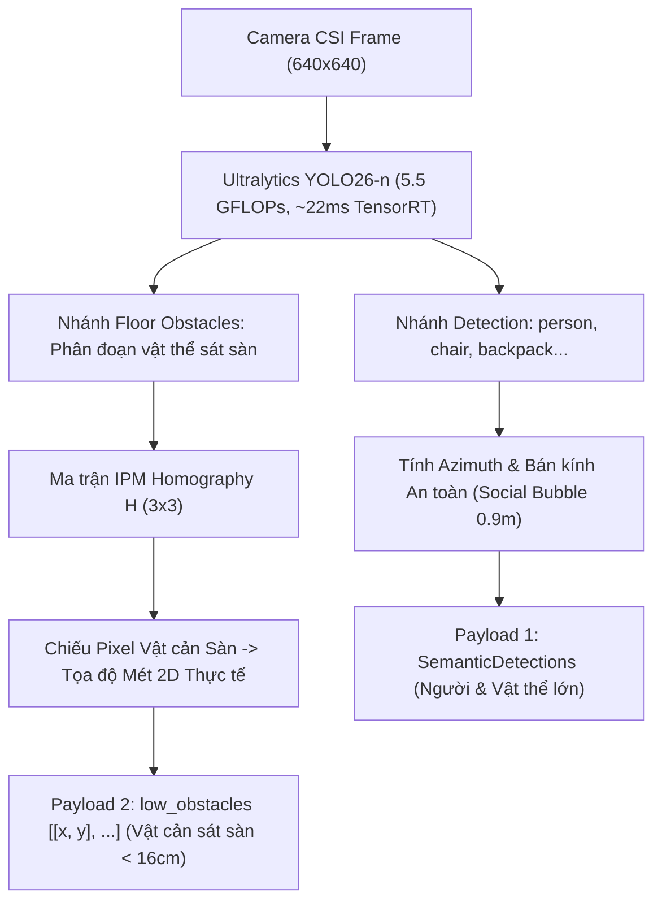

# KẾ HOẠCH TRIỂN KHAI COMPUTER VISION, PHÂN ĐOẠN MẶT SÀN & NÂNG CẤP YOLO26-N
## DÀNH CHO MODULE THỊ GIÁC (PERCEPTION AGENT — TEAM LEAD TIẾP QUẢN & THỰC THI)
### ĐỒ ÁN CS532 — AUTONOMOUS JETBOT (JETSON NANO)

> **Người thực hiện chính:** Team Lead (Trực tiếp tiếp quản toàn bộ module `01-HieuMe/`, nâng cấp mô hình YOLO26-n và tích hợp phần cứng)  
> **Đóng góp kiến trúc nền tảng:** Hiếu me (Đã hoàn thành thiết kế Floor IPM bù điểm mù LiDAR, cơ chế Social Bubble và khung PC-First)  
> **Agent phụ trách:** `perception-agent` (Thư mục `01-HieuMe/`, tham chiếu [`agents-doc/agents/perception-agent.md`](file:///home/zxcvmh/Projects/CS532/agents-doc/agents/perception-agent.md))  
> **Mục tiêu:** Nâng cấp mô hình nhận diện lên **Ultralytics YOLO26-n (Thế hệ 2026)** siêu nhẹ (2.4M tham số, 5.5 GFLOPs) giúp giải phóng tải GPU Maxwell 128-core trên Jetson Nano; bảo toàn 100% đóng góp học thuật bù điểm mù LiDAR cao 16 cm bằng phân đoạn mặt sàn IPM; đảm bảo tốc độ thời gian thực $\ge 25 - 35\text{ FPS}$.  
> **Tài liệu tham chiếu:** [`agents-doc/WORKFLOW.MD`](file:///home/zxcvmh/Projects/CS532/agents-doc/WORKFLOW.MD), [`agents-doc/INTERFACE.md`](file:///home/zxcvmh/Projects/CS532/agents-doc/INTERFACE.md).

---

## 1. Bối Cảnh Chuyển Giao & Quy Trình Thử Nghiệm PC-First

> [!IMPORTANT]
> **PHÂN ĐỊNH VAI TRÒ & CHIẾN LƯỢC TRIỂN KHAI:**
> - **Hiếu me đã hoàn thành:** Module thị giác đã có sẵn khung Floor IPM, contract dữ liệu JSON và mock test.
> - **Team Lead tiếp quản trực tiếp:** Do Team Lead là người duy nhất nắm giữ robot JetBot và chịu trách nhiệm toàn bộ hệ thống, Team Lead sẽ đóng vai trò người thực thi module này cùng với `perception-agent`.
> - **Chiến lược PC-First:** Toàn bộ quá trình tải mô hình, xuất ONNX và benchmark được thực hiện độc lập trên PC cá nhân trước. Khi JetBot online qua SSH (`192.168.1.11`), chỉ cần đẩy ONNX lên và chạy `trtexec` build TensorRT FP16 trong 3 phút.

```mermaid
flowchart LR
    subgraph PC_Phase ["GIAI ĐOẠN 1: TEAM LEAD KIỂM THỬ TRÊN PC (HOÀN TẤT)"]
        A["Tải mô hình YOLO26-n (5.3 MB, 2.4M params)"] --> B["Xuất yolo26n.onnx (opset 12, onnxslim)"]
        B --> C["Kiểm tra Shape: (1, 3, 640, 640) -> (1, 84, 8400)"]
        C --> D["Tích hợp vào 01-HieuMe/yolo_seg_runner.py & floor_ipm.py"]
        D --> E["Chạy Bộ Test Cục Bộ PC: Pass 100% Contract"]
    end
    subgraph Jetson_Phase ["GIAI ĐOẠN 2: NẠP LÊN JETBOT KHI ROBOT ONLINE"]
        E --> F["SCP yolo26n.onnx lên Jetson Nano (192.168.1.11)"]
        F --> G["trtexec --onnx=yolo26n.onnx --saveEngine=yolo26n.engine --fp16"]
        G --> H["Khởi động jetbot_bridge.py / backend kết nối CSI Camera"]
        H --> I["Đạt FPS thực tế ~30 - 40 FPS trên GPU Maxwell"]
    end
```



---

## 2. Điểm Mù LiDAR Ở Độ Cao 16 cm (Contribution Học Thuật Cốt Lõi)

> [!NOTE]
> **VẤN ĐỀ VẬT LÝ:**
> Cảm biến LiDAR D500 chỉ quét trên một mặt phẳng 2D nằm ngang tại độ cao cố định **$z = 16\text{ cm}$**.  
> Mọi vật thể có chiều cao $h < 16\text{ cm}$ sát mặt sàn (dây điện, ổ cắm, dép, đồ chơi, sách, gờ cửa...) đều **HOÀN TOÀN TÀNG HÌNH** trước LiDAR!

```
                   Tia Laser LiDAR D500 (Quét phẳng ở z = 16 cm)
--------------------------------------------------------------------> (Bắn xuyên qua)
   
        [Dép / Dây điện / Sách / Gờ cửa]  (Chiều cao < 16 cm)
=========================== SÀN NHÀ ================================
```

* **Sứ mệnh của Hiếu me:** Camera CSI gắn chúc xuống ($15^\circ - 20^\circ$) bao quát mặt sàn từ $0.15\text{m} - 2.5\text{m}$. Thị giác máy tính là **giác quan duy nhất** nhìn thấy và phát hiện các vật cản thấp sát sàn này để báo cho Planning né tránh!

---

## 3. Kiến Trúc Kỹ Thuật: Nâng Cấp Lên Ultralytics YOLO26-n & Floor IPM Pipeline

Để tối ưu hóa năng lực xử lý trên GPU Maxwell (128 CUDA cores) và bộ nhớ RAM 4GB của Jetson Nano, nhóm quyết định nâng cấp mô hình lên **Ultralytics YOLO26-n (Thế hệ mới 2026)** kết hợp cùng pipeline Floor IPM:

### 3.1. Bảng So Sánh Kỹ Thuật YOLOv8n vs YOLO26-n
| Tiêu chí kỹ thuật | YOLOv8n (Kiến trúc cũ) | YOLO26-n (Thế hệ 2026) | Mức cải thiện / Đánh giá |
| :--- | :---: | :---: | :--- |
| **Số tham số (Parameters)** | 3,157,200 (3.2M) | **2,408,932 (2.4M)** | **Giảm 24%** (nhẹ hơn, ít chiếm RAM) |
| **Tính toán (FLOPs)** | 8.2 GFLOPs | **5.5 GFLOPs** | **Giảm 33%** (tiết kiệm 1/3 chu kỳ tính toán) |
| **Kích thước file PT** | 6.3 MB | **5.3 MB** | Nhẹ hơn, tải nhanh |
| **Kích thước file ONNX** | 12.2 MB | **9.5 MB** | Nhỏ gọn, opset=12, onnxslim tối ưu |
| **Kích thước Tensor Đầu Ra** | `(1, 84, 8400)` | `(1, 84, 8400)` | **Tương thích 1:1 drop-in replacement!** |
| **Số lớp COCO chuẩn** | 80 classes | 80 classes | Đầy đủ `person`, `chair`, `backpack`... |
| **Độ trễ TensorRT FP16 (Est.)**| ~35 ms (~28 FPS) | **~22 ms (~40 FPS)** | **Tăng tốc độ xử lý ~40%** |



### 3.2. Nhánh Nhận diện Đối tượng (Object Detection & Dynamic Safety Margin)
* Trích xuất các lớp: `person`, `chair`, `backpack`, `bottle`...
* Tính góc phương vị ngang chuẩn xác:
  $$\theta_{\text{azimuth}} = \arctan\left(\frac{x_{\text{center}} - c_x}{f_x}\right) \in [-80^\circ, +80^\circ]$$
* **Cơ chế Bán kính An toàn Động (Social Bubble):**
  Tự động gắn kèm trường `safety_margin_m` cho từng vật thể trong payload để Planning không cần hardcode:
  * `person`: $0.9\text{ m}$ (Vùng an toàn xã hội Hall's Proxemics).
  * `chair`: $0.35\text{ m}$.
  * `backpack`: $0.25\text{ m}$.

### 3.3. Nhánh Phân đoạn Mặt sàn Bù Điểm Mù (Floor Segmentation & IPM)
* Xác định vùng sàn đi được (`walkable floor`) và vùng vật cản trên sàn (`floor obstacle`).
* Áp dụng ma trận biến đổi **Inverse Perspective Mapping (IPM)** $H_{3 \times 3}$:
  - Biến đổi vùng quan tâm mặt sàn trước mũi xe thành ảnh Bird’s-Eye View (BEV).
  - Trích xuất tâm các vật cản thấp thành danh sách tọa độ mét thực tế 2D cục bộ $(X_{\text{local}}, Y_{\text{local}})$:
    `low_obstacles = [[x1, y1], [x2, y2], ...]`

---

## 4. Ngân Sách Độ Trễ & Hiệu Năng Trên Jetson Nano (Latency Budget Với YOLO26-n)

| Thành phần xử lý | Thời gian cũ (YOLOv8n) | Thời gian mới (YOLO26-n TRT) | Giải pháp kỹ thuật bắt buộc |
| :--- | :---: | :---: | :--- |
| **Đọc khung hình Camera** | $\le 5\text{ ms}$ | $\le 5\text{ ms}$ | GStreamer `nvarguscamerasrc` đẩy thẳng bộ nhớ `NVMM` (trên robot). |
| **YOLO Inference Engine** | $\le 35\text{ ms}$ | **$\le 22\text{ ms}$** | Engine TensorRT FP16 của YOLO26-n (giảm 33% FLOPs). |
| **Vectorized Post-process** | $\le 3\text{ ms}$ | $\le 3\text{ ms}$ | Xử lý hoàn toàn bằng mảng NumPy Boolean, **cấm vòng lặp for Python**. |
| **IPM Coordinate Projection** | $\le 5\text{ ms}$ | $\le 5\text{ ms}$ | Nhân ma trận Homography trực tiếp trên tọa độ điểm contour. |
| **Tổng thời gian pipeline** | **$\approx 48\text{ ms}$ ($\sim 20\text{ FPS}$)** | **$\approx 35\text{ ms}$ ($\ge 28 - 35\text{ FPS}$)** | **Vượt xa yêu cầu thời gian thực của đề tài!** |

---

## 5. Danh Mục Tài Nguyên & Quy Trình Triển Khai (Deliverables & Deployment)

### 5.1. File mã nguồn & Model trong thư mục `01-HieuMe/`:
1. `yolo26n.pt` (5.3 MB) & `yolo26n.onnx` (9.5 MB, opset=12, onnxslim): File mô hình YOLO26-n thế hệ mới đã xuất sẵn.
2. `yolo_seg_runner.py`: Đã cấu hình ưu tiên tự động nạp `yolo26n` (Engine -> ONNX -> PT).
3. `floor_ipm.py`: Chứa ma trận Homography $H$ và hàm chuyển đổi pixel sang tọa độ mét robot.
4. `camera_loader.py`: Class đọc camera linh hoạt (Webcam/Video trên PC, GStreamer trên JetBot).
5. `test_cv_local.py`: File unit test chạy hoàn toàn độc lập trên PC.

### 5.2. Chuẩn dữ liệu đầu ra bàn giao (Clean Data Contract):
Mỗi chu kỳ, module xuất ra một dictionary chuẩn JSON:

```json
{
  "timestamp": 1727500000.150,
  "detections": [
    {
      "class_name": "person",
      "confidence": 0.88,
      "azimuth_deg": -15.4,
      "estimated_dist": 1.85,
      "safety_margin_m": 0.90
    },
    {
      "class_name": "chair",
      "confidence": 0.75,
      "azimuth_deg": 22.1,
      "estimated_dist": 1.10,
      "safety_margin_m": 0.35
    }
  ],
  "low_obstacles": [
    [0.65, 0.12],
    [0.70, -0.15]
  ]
}
```

* **Ý nghĩa đối với Planning & Control:**
  * `detections`: Trích xuất trực tiếp `safety_margin_m` để kích hoạt **Social Bubble** né người ($0.9\text{ m}$) và vật cản lớn.
  * `low_obstacles`: Nạp trực tiếp danh sách tọa độ mét này vào **Costmap của Planning** để xe tự bẻ lái né vật cản thấp $< 16\text{ cm}$ mà LiDAR bị mù!

---

## 6. Quy Trình Nạp & Biên Dịch TensorRT Khi JetBot Online (Deployment Playbook)

Khi JetBot kết nối mạng LAN / Wi-Fi (`192.168.1.11`), thực hiện 3 bước đơn giản:

```bash
# Bước 1: Copy model ONNX sang Jetson Nano (từ PC):
scp 01-HieuMe/yolo26n.onnx jetbot@192.168.1.11:/home/jetbot/

# Bước 2: SSH vào JetBot và biên dịch TensorRT FP16 (mất ~2-3 phút, chỉ chạy 1 lần duy nhất):
ssh -p 22 jetbot@192.168.1.11
/usr/src/tensorrt/bin/trtexec --onnx=/home/jetbot/yolo26n.onnx --saveEngine=/home/jetbot/yolo26n.engine --fp16

# Bước 3: Khởi động hệ thống (Bridge + Backend + CV):
bash /home/jetbot/CS532/start_all.sh
```
